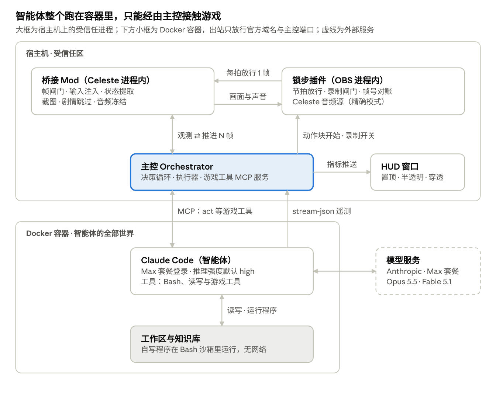
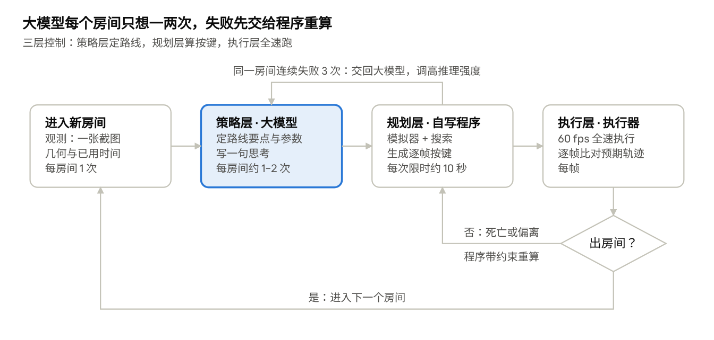

# Celeste_AI_Play


> **项目尚未完成。** 目前已有桥接 Mod、主控、断网的智能体容器、工作区与知识库、两种 HUD（画在游戏画面里的 MOD 形式与可交互的网页形式）、图形界面的控制台、OBS 锁步录制（完整版与纯享版，录像专用的独立游戏声音）、逐帧精确的预置模拟器（带检查点）、速通 / 探索 / 直播三种游玩模式、原生 GPT 执行器，以及一键部署脚本与部署文档；正式挑战（M7）的流程已在 test 存档上彩排通过，尚未完成正式运行。完成全部里程碑之前，此处会一直保留"未完成"标注。

让大模型智能体（Opus 5.5、Fable 5.1 等，也可以通过兼容接口接入其他平台的模型，如 DeepSeek，或通过本机 Codex 接入 GPT）独立游玩《蔚蓝》（Celeste）官方章节：游戏可逐帧暂停，智能体想好下一段操作后再推进；OBS 只录下真正推进的游玩帧，跳过所有思考时间。

本项目正式挑战的目标：**从一个新存档进入序章起，依次通关序章、1A 与 2A，游戏内章节计时尽可能短。** 现实时间是次要指标，只设一个宽松的上限（最初的设想是 2 小时内通关 1A 与 2A，现已放宽）。正式挑战每个智能体用一个新存档（本项目用 `opus5.5`、`fable5.1`、`dsflashv4.1`），调试与工具准备在单独的 `test` 存档上进行、不计成绩。你在自己电脑上部署时可以用任意存档名。

## 当前进度

| 里程碑 | 内容 | 状态 |
| --- | --- | --- |
| 设计 | 整体框架、实现原理、提速方案 | 已完成初稿 |
| M0 环境准备 | 安装 Everest，创建正式挑战存档（opus5.5、fable5.1）与 test 存档，建好仓库结构 | 已完成 |
| M1 桥接 Mod 基础 | 帧闸门、输入注入、状态提取、画面截取、IPC、菜单宏 | 已完成 |
| M2 单智能体闭环 | 主控、智能体运行时、act 工具，在序章跑通 | 已完成（test 存档序章 4 分 39 秒通关） |
| M3 沙箱、工作区与知识库 | Claude Code 容器与出站白名单、程序工作区、知识库生成与审核、压缩计数 | 已完成（隔离验收全部通过；知识库含技巧总表与机制库，内容待审核） |
| M4 分层执行 | 执行器、计划文件执行、偏差监控、自动重试 | 已完成（验收全部通过；Opus 实测中自写模拟器与搜索，按计划文件连续通过 4 个房间） |
| M5 HUD | 右上角信息卡片 | 已完成（MOD 形式画在游戏画面里；网页形式供 HUD 窗口与 OBS 浏览器源共用；执行中逐帧更新） |
| M6 录制 | OBS 锁步插件（方案 B）与录像声音 | 已完成（成片帧数等于游玩帧数，逐帧条码核对一致；默认用录像专用的独立游戏声音，完整版与纯享版两条音轨） |
| 预置模拟器 | 由完整游戏代码逐帧推演的模拟器，按开关只读挂进智能体容器 | 已完成（序章与第 1–9 章 A 面（8A 核心、9A 告别）的校准用例全部逐帧一致；`--sim` 挂进容器后实测与游戏逐帧一致。模拟器本身含反编译代码，只留在开发者本机，不入库） |
| 控制台 | 图形界面：设置并启动运行、运行中介入与对话、续跑与交还控制 | 已完成（在 test 存档上实测启动、发消息、暂停与继续、中断、续跑、交还控制） |
| 部署 | 一键部署脚本与部署文档 | 已完成（`setup.ps1` + 部署向导，`-Check` 在开发环境实测通过；见 [docs/DEPLOY.md](docs/DEPLOY.md)） |
| 原生 GPT 与直播 | Codex 原生执行器、可交互网页 HUD 与会话管理、直播模式、探索模式 | 已完成序章与 1A 的实际试玩；探索模式的限额模拟待实局验收（见 [docs/LIVE_ADAPTATION.md](docs/LIVE_ADAPTATION.md)） |
| M7 正式挑战 | 从正式存档进入序章开始计时，通关序章、1A 与 2A，以游戏内计时为主要成绩 | 准备就绪，尚未完成正式运行（依次通关多章、额度等待、中断续跑均已实测；序章 → 1A → 2A 的自动衔接在 test 存档上彩排通过。2026-10-23 Fable 5.1 与 DeepSeek V4.1 Flash 的首轮运行开跑后提前中止，据此调整了录制、HUD、规划方式与提示词；2026-10-24 加入开 / 关模拟器两个版本、模拟器检查点、实时解说、纯享版录像、一键部署与三种游玩模式，等待重新开跑） |

## 工作原理



- **桥接 Mod**（Everest Mod，运行在游戏进程内，当前版本 1.1.1）：逐帧暂停与放行游戏、注入按键、提取 Madeline 状态与碰撞箱、截图，并报告暂停菜单状态，让主控像玩家一样通过暂停菜单跳过剧情；另外负责规划回放的绘制、MOD 形式 HUD 的绘制、录像专用的独立游戏声音，以及新建存档。
- **主控**：唯一同时连接游戏、智能体、HUD 与 OBS 的组件，负责决策循环、执行与日志；智能体用 `set_effort` 申请调整推理强度时，在两轮之间替它切换；执行智能体程序算出的计划，偏离预期时停下（默认还可在零网络沙箱里运行智能体的重算程序自动重试）；`--limit-planning` 时按章节的规划轮次放行或拒绝容器里的工具调用；执行之前把这次规划在模拟器里推演过的路线画进游戏（规划回放）；一章通关后自动进入下一章；Max 额度用完时让游戏冻结、等额度重置后接着玩。
- **预置模拟器**（速通模式下默认开启，`--no-sim` 关闭）：由完整游戏代码逐帧推演的无画面模拟器，从游戏导出的某一帧完整场景出发，给出任意按键之后每一帧的结果，与真实游戏逐帧一致；推演到中途的任何一帧都能存成检查点、从检查点接着推演。只读挂进容器供智能体调用。它含反编译代码，只在开发者本机构建，不在仓库里（见下文"不在仓库里的本机文件"）。这个开关把速通模式分成两个版本，提示词各一套，目标都是以最短的章节计时通关：开模拟器时智能体可以随意调用模拟器寻找并优化路线；关模拟器时智能体不能调用模拟器，提示词不教打法，只靠它自己的办法——它不管用什么方法算出 Madeline 的逐帧轨迹，都可以交给展示接口，系统同样画给观众看（只用于展示，不影响成绩）。本项目的正式挑战用开模拟器的版本。探索模式不开放模拟器文件，只能用有额度的短路线预测（`--sim-assist`）。
- **智能体运行时（执行器）**：默认使用 Docker 内的官方 Claude Code（`--engine claude`），以 Max 套餐登录；也可以用 `--provider` 接入兼容 Anthropic 接口的平台（如 DeepSeek）。`--engine codex` 则使用宿主机上 Codex app-server 的已有登录接入 GPT，模型进程在宿主机，它生成的程序仍在 Docker 零网络沙箱执行。两种执行器共用游戏工具、提示词、知识库，以及网页 HUD 里的新建、准备、聊天、取名、切换和唤醒流程；会话管理中可选择执行器与提供方。GPT 不再经过"Anthropic 接口 → OpenAI 接口"转换网关接入（旧的 `--provider openai` 预设已移除）；自定义的 Anthropic 兼容服务仍可配置。凭据不入库，智能体自写的程序看不到凭据与游戏进程。
- **HUD**：显示游戏时间（章节计时）、推理强度、思考与工具时间、上下文大小、压缩次数、知识库读取用时、死亡次数、模拟器调用次数、当前这次调用推演的路径条数、当前房间推演出的最速用时、正在调用的工具（放不下时折行）与思考语句；规划回放时显示第几轮、推演了多少条路线；探索模式开了限额预测时显示推演额度（关掉时不显示推演相关的几栏）。有两种形式：
  - **MOD 形式**（`--hud-mod`，不开直播时默认）：主控把卡片与最近几条思考语句画成图片，桥接（0.13.0 起）把它画在游戏画面右上角，章节计时按当帧游戏时间画、逐帧准确；智能体的观测截图里没有它；这时不打开置顶窗口，OBS 浏览器源里的网页 HUD 也隐藏，录像里只有游戏画面里的一份。
  - **网页形式**（`--no-hud-mod`，直播模式默认）：同一个页面既是屏幕上的独立 HUD 窗口（无边框，可拖动、缩放、切换置顶，关闭后留在托盘），也是 OBS 浏览器源；桌面窗口里另有聊天输入框、暂停 / 继续、会话管理、目标与停止条件等控件，OBS 里只显示公开内容（见 [docs/LIVE_ADAPTATION.md](docs/LIVE_ADAPTATION.md)）。

  所有模式下智能体思考期间都可以用 `narrate` 随时更新 HUD 上的思考语句，运行程序期间用工作区的 `show.status()` 报告进度；系统内置解说计时器，思考累计满半分钟（直播模式 10 秒）没有更新，就在它下一次调用工具时提醒。
- **OBS 锁步插件**：录制时 OBS 每个视频节拍向游戏要一帧，游戏推进一帧、画完再回复；插件自带的录制输出只把这些帧交给 ffmpeg，思考期间一帧也不写，成片帧数与游玩帧数一一对应。默认通过独立 FMOD 混音生成录像专用的游戏声音（`configs/recording.json` 的 `audio_source: "game_nrt"`，需要桥接 0.12.7 起与同步更新的 OBS 插件）：不输出到声卡，按帧混出两条音轨——完整版音轨 `audio.wav` 在规划回放帧里继续放音乐（音效暂停），纯享版音轨 `audio_play.wav` 只随真实游戏帧推进，所以完整版与纯享版的音乐都是连贯的；思考与暂停期间两条都不推进；直播时游戏本身的声音仍可连续播放 BGM。锁步成片只收游戏声音，OBS 原有的推流音轨保持不变。`audio_source: "obs_mix"` 可切回原来的 OBS 混音裁切与声音偏移校准方式。每次录制出两个版本：含规划回放的完整版 `gameplay.mp4`，和只有真实游玩帧的纯享版 `gameplay_pure.mp4`。录屏默认开启（`--no-record` 关闭）：OBS 没在运行时主控自己启动它、结束时关掉。

智能体容器的隔离已逐项验收（`python -m orchestrator.verify`）：容器里的 Claude Code 只能连到所用模型平台（默认 Anthropic 官方域名）与主控的游戏工具端口，连不上任何网站，也连不上游戏桥接端口；它用 Bash 运行的自写程序处在零网络的沙箱里，连 Anthropic 也连不上，也看不到登录令牌；它改不了防火墙与托管配置，也不读取任何可被它改写的设置文件。原生 GPT 执行器的模型进程在宿主机上，但它的文件工具只能读 `/workspace`、`/kb`、`/sim`、只能写 `/workspace`，生成的程序同样在零网络沙箱里运行。工作区 `workspaces/<标签>/` 跨运行保留，主控每次观测都把房间数据写进去；知识库 `kb/` 只读挂载，只讲游戏规则，不讲关卡怎么过。

在速通模式下，为了在合理的现实时间内打出短的游戏内计时，智能体按三层控制工作：大模型规划路线，具体按键由程序搜索生成（开模拟器的版本用预置模拟器，关模拟器的版本用它自己的办法），执行器以 60 fps 全速执行。默认不限制思考与模拟器调用，观测里也不显示现实用时与预算：智能体把整个房间在模拟器里推演到出口、找到能过的路线之后继续优化，优化完再一次执行，没推演到出口的路线不执行，需要分段搜索时用检查点，搜索怎么写由它自己决定（`--limit-planning` 打开按章节记账的规划轮次：一屏大小的房间 3 轮，长、高每加倍轮次翻倍，至少 3 轮，死一次补 1 轮，只有调用模拟器的消息占一轮）。每规划完一轮（一条调用了模拟器的消息），主控就把这一轮在预置模拟器里推演过的路线按推演先后画进游戏（规划回放）：每 100 条推演画一条、每轮至少 40 条，3 倍速，每轮最长 1.5 秒（以 1A 第一间一屏大的房间为准，按房间面积等比放大，超过时整轮按比例加速），线条延伸时是绿色，死亡的线从死亡点往回变红，这一轮最快的一条变成金色，镜头跟着金色路线走（变金时跟着变色点往回移），放完变灰留在画面上，开始真实执行时全部清掉；回放不推进游戏、不计章节计时，照常录进录像，完整版录像里音乐照常播放。



完整设计见 [docs/DESIGN.md](docs/DESIGN.md)。

## 快速开始

在一台装好 Steam 版《蔚蓝》的 Windows 电脑上：

```powershell
git clone https://github.com/fluency753/Celeste_AI_Play.git
cd Celeste_AI_Play
powershell -ExecutionPolicy Bypass -File .\setup.ps1          # 一键部署：逐步检查与安装，配置平台、存档与开关，生成启动脚本
.\start_local.ps1 -Trial                                      # 在调试存档上试跑
.\start_local.ps1                                             # 正式挑战
.\CelesteAIConsole.exe                                         # 或者打开控制台，在图形界面里设置并开始
```

也可以直接运行主控（下面的 `opus5.5`、`test` 是本项目的存档名，换成你游戏里的存档名）：

```powershell
# 正式挑战：默认速通模式（不开直播），预置模拟器、规划回放、OBS 录屏、游戏内 HUD 都默认开启
.\.venv\Scripts\python.exe -m orchestrator.run --agent opus5.5 --save opus5.5 --model opus --chapters 0,1,2 --max-minutes 600
# DeepSeek，在调试存档上试跑、不录屏
.\.venv\Scripts\python.exe -m orchestrator.run --agent dev-deepseek --save test --provider deepseek --model deepseek-flash --chapter 0 --no-record
```

### 用控制台

不想记命令行参数时，双击仓库根目录的 `CelesteAIConsole.exe` 打开控制台（部署完成后才能用：它用 `.venv` 里的 Python 打开控制台），或者：

```powershell
.\.venv\Scripts\python.exe -m overlay.console              # 独立窗口
.\.venv\Scripts\python.exe -m overlay.console --browser    # 或用浏览器打开 http://127.0.0.1:47790/console
```

控制台有五个页面：

- **运行**：选执行器、模型、推理强度、游玩模式、各个开关与其余全部参数（包括规划回放倍速、解说提醒间隔、探索模式规划程序的时长与次数等可调参数），然后开始运行；运行中暂停或继续、调整推理强度、给沙箱里的智能体发消息，或者停止、中断运行；运行结束后续跑，或交还游戏控制。
- **存档与章节**：地图（目前只有蔚蓝官方章节）、游戏位置（填一次就记住）、存档与要依次通关的章节。
- **知识库**：按游玩模式查看、编辑智能体能读到的知识库文件，勾选每个文件的阅读权限。
- **提示词**：按运行页的当前设置预览智能体会收到的提示词全文（标出每一段来自哪个文件）与准备阶段的第一条消息；可以编辑并保存为本机修改，随时恢复仓库版本。
- **关于**：版本、当前环境、项目地址、作者、待办与更新记录。

页面底部实时显示等价的命令行。控制台启动的运行在独立的后台进程里进行，关掉控制台窗口不影响它。详见 [docs/USAGE.md 4.10 节](docs/USAGE.md#410-控制台在图形界面里设置启动与介入运行)。

### 用原生 GPT 游玩

需要先在本机安装 Codex CLI 并用 `codex login` 登录（主控不读取、不复制登录凭据）。`start_gpt.ps1` 是原生 GPT 执行器的快捷入口，默认用探索模式：只读 `kb/explore` 里的入门资料（基本规则、坐标与观测数据、按键与工具；另有选读的操作提示），不挂载完整知识库与模拟器文件；本机有预置模拟器时默认提供有额度的短路线预测，HUD 显示体力余额。每次准备都开新的会话；探索模式的工作区（`workspaces/<标签>-explore`）与速通模式分开，不会读到速通的笔记（网页 HUD 的"新建并准备"还会为每个会话生成独立的标签与工作区）。

```powershell
.\start_gpt.ps1                                                                   # 只准备：读入门资料、建会话（不连游戏）
.\start_gpt.ps1 -Play -Prepared runs\gpt-native\<准备目录> -Chapter 1 -Save <存档名> -SaveSlot <槽位>   # 用已有存档试玩
.\start_gpt.ps1 -Play -Prepared runs\gpt-native\<准备目录> -Chapter 0 -Save <新存档名> -CreateSave       # 新建存档，从序章开始
.\start_gpt.ps1 -Play -Resume runs\gpt-native\<运行目录>                           # 续跑
```

试玩时带直播模式（`--live`），默认通过独立的后台宿主运行（`orchestrator.background`），关掉启动它的终端或聊天窗口不会结束试玩；加 `-Foreground` 则在当前终端运行。`-Knowledge full` 改用速通模式。也可以在网页 HUD 的"会话管理"里新建、准备并开始试玩。详见 [docs/LIVE_ADAPTATION.md](docs/LIVE_ADAPTATION.md)。

环境要求、手动部署步骤与每个命令的细节见 [docs/DEPLOY.md](docs/DEPLOY.md)。

## 游玩模式

速通模式与探索模式二选一（`--mode`），直播模式（`--live`）可以和任一个叠加。主控给智能体的提示词按 模式 × 直播 严格分版本。

| 模式 | 知识库 | 模拟器 | 提示词 | 智能体的游戏工具 |
| --- | --- | --- | --- | --- |
| 速通模式 `--mode speedrun`（Claude 执行器默认） | 完整知识库 `kb/` | `--sim`（默认，开放预置模拟器）或 `--no-sim` | 以最短章节计时通关：开模拟器版写明做法；关模拟器版只写目标、规则与接口；都有 HUD 一节（narrate 与工具状态，解说计时半分钟） | observe、act、narrate、set_effort、stop_run |
| 探索模式 `--mode explore`（原生 GPT 默认） | 只有 `kb/explore`（基本操作与工具说明） | 不开放模拟器文件；`--sim-assist`（本机有预置模拟器时默认开）提供有额度的短路线预测 | 新手探索、学习并完成指定章节，不以速通为目标 | 另有 cutscene；开了限额预测时有 simulate |
| 直播模式 `--live`（叠加，默认关） | — | — | 速通 + 直播：加"直播"一节（观众实时观看、解说计时 10 秒、用户可要求退出关卡），不改变速通目标；探索 + 直播：另加探索的直播节奏（每次决策约 10～20 秒、每 5～10 秒解说） | 另有 exit_level、cutscene |

直播模式下 HUD 默认是可交互的网页形式；不开直播时 HUD 默认以 MOD 形式显示在游戏画面右上角。剧情默认由主控像玩家一样用暂停菜单跳过；`--cutscene-mode agent` 把剧情交给智能体（主控自动播放到需要输入的节点，智能体用 cutscene 工具推进对白、选择分支或跳过；需要桥接 1.0.4 起），这时速通模式也会开放 cutscene 工具。所有模式都有 stop_run：智能体遇到工具故障等无法继续的情况时报告给用户，主控暂停试玩、章节内保持冻结，菜单正常运行，由用户决定继续还是停止。

## 开关

主控 `python -m orchestrator.run` 的全部开关与参数（`--help` 列出同样的内容）。续跑（`--resume`）时，标了"沿用"的项不写就沿用原运行的设置。

**版本与功能开关**

| 开关 | 默认 | 作用 |
| --- | --- | --- |
| `--engine claude` / `--engine codex` | `claude`（沿用） | 执行器：`claude` 是 Docker 里的 Claude Code；`codex` 是宿主机 Codex app-server 的原生 GPT（程序仍在 Docker 零网络沙箱里运行） |
| `--mode speedrun` / `--mode explore` | 按执行器：Claude 速通，原生 GPT 探索（沿用，续跑不能改） | 游玩模式，见上一节；旧参数 `--knowledge full/explore` 等同 |
| `--sim` / `--no-sim` | 速通模式且容器运行方式时开（沿用） | 只用于速通模式：预置模拟器，把速通模式分成两个版本。开：模拟器只读挂进容器，智能体可以随意调用它寻找并优化路线，提示词写明做法；关：不能调用模拟器，提示词不教打法，只写目标、规则与工具接口，智能体自己想办法（算出的轨迹可以交给展示接口画出来） |
| `--live` / `--no-live` | 关（沿用） | 直播模式，见上一节。`narrate` 与思考提醒在所有模式下都有：智能体思考期间用 `narrate` 随时更新 HUD 的思考、运行程序时用 `show.status()` 报告进度；思考满半分钟（直播 10 秒）没更新时提醒它 |
| `--sim-assist` / `--no-sim-assist` | 探索模式且本机有预置模拟器时开（沿用） | 只用于探索模式：有额度的短路线预测（不开放模拟器文件）；规则见 [LIVE_ADAPTATION.md](docs/LIVE_ADAPTATION.md#探索模式的模拟体力) |
| `--stiffness` / `--no-stiffness` | 关（沿用） | 只用于探索模式：思考僵直——冻结期间的思考与工具时间按比例变成下一次 act 前的僵直（保持上一帧按键），规则见 [USAGE.md](docs/USAGE.md) |
| `--collision-image always` / `room` / `off` | 按执行器（沿用） | 工具结果里附碰撞图的时机：每次、只在进新房间与 observe 时、不附。没指定时 Codex 执行器每次都附，其余执行器只在进房与 observe 时附；工作区里每次照样写图，需要时自己读 |
| `--formal-thought` / `--no-formal-thought` | 关（沿用） | 仅正式思考：冻结期间 `narrate` 写的临时思考只显示在控制台（Claude Code 执行器每条汉字不超过 120 个）；每次 act 的 `thought` 是正式思考，概括整个冻结期间的思考（汉字不超过 30 个），游戏内 HUD 只显示当前这一句、字号更大。规则写进提示词与工具说明 |
| `--save-context` / `--no-save-context` | 开（续跑沿用） | 节省上下文：同一房间里的 act 结果省略每次都一样的部分（观测文件只给一行路径、帧号与快照编号；不列可选推理强度；没有僵直时不写僵直说明；不重复本房间范围），进新房间与 observe 照常给全；探索提示词轻提大块输出只打印关心的区域。关掉时与原来一样 |
| `--cutscene-mode auto` / `agent` | `auto`（沿用） | 剧情：`auto` 由主控用暂停菜单跳过（跳不过时推进对白）；`agent` 交给智能体用 cutscene 工具处理 |
| `--allow-restart-chapter`、`--allow-return-to-map`、`--allow-save-quit` | 均禁止（续跑沿用） | 三项独立操作权限，各有 `--no-allow-...` 形式；控制台/HUD 可实时修改并通知会话。需要桥接 1.1.1 的 `action_policy=1`，正常死亡、房间重试和已核验换章保留，见[策略契约](docs/CHAPTER_RESET_GUARD.md) |
| `--allow-chapter-reset` / `--no-allow-chapter-reset` | 兼容旧总开关 | 一次设置全部三项，独立选项优先；旧配置、运行和偏好可迁移 |
| `--record` / `--no-record` | 开（沿用） | OBS 录屏。开：OBS 没在运行就由主控启动，锁步录制完整版与纯享版，结束时关掉它启动的 OBS（已经开着的 OBS 直接用、不关）；关：不启动、不调用 OBS |
| `--playback` / `--no-playback` | 开（沿用） | 规划回放。开：每规划完一轮，把推演过的路线按轮画进游戏给观众看（开模拟器时画 `/sim` 的推演，关模拟器时画智能体交来的轨迹），不推进游戏、不计章节计时；关：不画 |
| `--limit-planning` | 关 | 限制规划轮次：按章节记账，每个新房间按大小存入轮次，死亡补 1 轮，只有调用模拟器的消息占一轮，自动重试随之关闭；只用于开模拟器的版本 |
| `--no-study` | 关 | 跳过准备阶段（开局读完知识库），调试用 |
| `--no-quota-wait` | 关 | Max 额度用完时直接停止，而不是冻结游戏、等额度重置后接着玩 |
| `--hud-mod` / `--no-hud-mod` | 不开直播时开，直播模式关（沿用） | HUD 以 MOD 形式画在游戏画面右上角：旧版卡片（大号章节计时、推理强度、统计两列、调用工具）加思考语句历史，章节计时由桥接按当帧游戏时间画、逐帧准确；智能体的观测截图里没有它。开着时不打开置顶 HUD 窗口，OBS 浏览器源里的网页 HUD 也不显示（录像里只有游戏画面里的一份）。关着时用可交互的网页 HUD。需要桥接 0.13.0，旧桥接自动改用网页 HUD |
| `--no-hud-window` | 关 | 不在屏幕上打开网页 HUD 窗口（录像里的 HUD 不受影响；游戏内 HUD 开着时本来就不打开） |
| `--no-hud` | 关 | 连 HUD 服务也不启动 |
| `--record-marker` | 关 | 录制时在画面左下角画帧号条码，只用于校准 |
| `--skip-enter` | 关 | 已在关卡内可操作时跳过菜单宏 |
| `--no-agent` | 关 | 只启动游戏工具服务、不启动智能体，手动调试用（见下文"手动调用游戏工具"） |
| `--keep-obs-open` | 关 | 主控结束后保留它启动的 OBS，供直播继续使用；锁步录像正常收尾。手动关闭 OBS 后可运行 `python tools/obs_setup.py restore` 还原原先的配置选择 |
| `--continuous-music` / `--freeze-music` | `configs/local.recording.json` 的 `continuous_music`，没写时冻结 | 前者在冻结游戏逻辑时保持游戏本身的 BGM 播放、暂停音效，适合直播；后者音乐也冻结。默认的独立游戏声音（`game_nrt`）录像不受它影响；改用 `obs_mix` 录音时，前者按固定的 `audio_offset_ms` 对齐声音，后者按每段的静音恢复边逐段校准 |
| `--start-paused` | 关 | 原生 GPT 启动后保持暂停，可先在 HUD 里聊天，再点"继续" |
| `--fresh-session` | 关 | 与 `--resume` 一起用：开一个新的智能体会话，不接原来的 |

**运行参数**

| 参数 | 默认 | 作用 |
| --- | --- | --- |
| `--agent <标签>` | 必填 | 智能体标签：决定容器 `celeste-agent-<标签>`、工作区 `workspaces\<标签>\`、日志 `runs\<标签>\`（探索模式的容器与工作区另加 `-explore` 后缀） |
| `--save <存档名>` | 必填 | 游戏内存档名，与当前存档不一致时拒绝开始 |
| `--save-slot <槽位>` | 无（沿用） | 已有存档的槽位编号；同名存档按槽位区分 |
| `--create-save` | 关 | 新建存档：放在现有最新存档的下一个槽位（不填中间的空位），名称允许重复；只能从序章开始（`--chapter 0`），不能与 `--resume`、`--skip-enter`、`--save-slot` 合用 |
| `--provider` | `anthropic`（沿用） | 模型平台：`anthropic`（Max 订阅令牌）、`deepseek`，或 `configs/local.providers.json` 里自定义的兼容 Anthropic 接口的平台；原生 GPT 不用它 |
| `--model` | Claude：`opus`；原生 GPT：Codex 登录配置的默认模型（沿用） | Anthropic 用别名（`opus`、`fable`、`haiku`）；第三方用它自己的模型名；原生 GPT 用 Codex 模型目录里的模型名 |
| `--effort` | Claude：`high`；原生 GPT：`medium`（沿用当时生效的） | 开局推理强度；可选档位由所选模型声明（Anthropic 与 DeepSeek 的模型都是 `low` / `medium` / `high` / `xhigh` / `max`）；智能体可以用 `set_effort` 自己调整 |
| `--chapters 0,1,2` | 无 | 依次通关的章节（0 序章、1 1A、2 2A……），一章通关后自动进入下一章 |
| `--chapter N` | 选章页当前章节 | 只玩一章（或作为 `--scope campaign` 的起始章节） |
| `--scope chapter` / `campaign` | `chapter`（沿用） | 没给 `--chapters` 时：`chapter` 只玩一章，`campaign` 从起始章节起按官方章节顺序一直玩下去 |
| `--prepared <准备目录>` | 无 | 用已准备好的会话新开一局（先核对知识库没有变化）；不能与 `--resume`、`--no-study` 合用 |
| `--max-minutes` | 240（沿用） | 现实时间安全上限（不含准备阶段与等待额度），不显示给智能体 |
| `--study-minutes` | 60 | 准备阶段上限，到时自动开放游戏工具 |
| `--resume <运行目录>` | 无 | 续跑一次中断的运行（游戏须仍冻结在原处） |
| `--max-usage 0~1` | 不设 | Max 订阅：用量到这个比例就提前暂停、等重置 |
| `--quota-wait-max-hours` | 24 | 额度重置还要等超过这么多小时就停止本次运行 |
| `--rounds-per-room` / `--room-scale` | 3 / 2 | `--limit-planning` 时：一屏大小的房间存入几轮 / 房间长、高每变成几倍轮次乘几 |
| `--autocompact` | 平台默认 | 上下文自动压缩的窗口：`auto` 或 100000～1000000 token |
| `--tune 名称=值` | 不改 | 修改一个可调参数，可以写多个（沿用）：规划回放倍速与每轮最长时长、解说提醒间隔、单次 act 帧数、Bash 时长、探索模式规划程序的时长与次数、限额预测规则等，全部名称与默认值见 [docs/USAGE.md 4.11 节](docs/USAGE.md#411-可调参数--tune) |
| `--kb-deny 文件,...` | 全部可读 | 不给智能体看的知识库文件（沿用），见 [docs/USAGE.md 4.12 节](docs/USAGE.md#412-知识库的阅读权限--kb-deny) |
| `--kb-extra 目录` | 不追加 | 追加本机资料目录（放在 `local/` 下、不入库；同名文件覆盖默认版本；沿用），见 USAGE.md 4.12 节 |
| `--runtime` | `container`（沿用） | `host`：在本机运行、只开放游戏工具（早期的过渡方式，没有沙箱与模拟器） |
| `--ffmpeg` / `--record-video-args` / `--audio-offset-ms` | 见录制配置 | 临时覆盖 ffmpeg 路径、视频编码参数、声音偏移 |
| `--bridge-port` / `--mcp-port` / `--hud-port` | 47774 / 47780 / 47790 | 桥接、游戏工具服务、HUD 的端口 |
| `--play-speed` / `--auto-speed` | 1 / 1 | 动作段 / 转场与剧情段的推进速度，大于 1 是快进，只用于调试（录像会失真） |

Claude 执行器的运行没通关就停下（时间预算用完、出错、Ctrl+C）时，章节内保持冻结在当前帧，菜单正常运行（章节计时不走），可以用 `--resume` 续跑。原生 GPT 也支持控制台的显式“中断（保持冻结，可续跑）”；普通停止、通关、退出关卡以及 `--no-agent` 结束仍交还控制。保留接管时也保留录制，续跑接续首次运行目录中的同一份录像；OBS 与游戏必须保持运行。不续跑时从控制台“交还游戏控制”，先收尾录像再恢复游戏。已经收尾的旧录像不能追加。

**部署与启动脚本**

| 命令 | 作用 |
| --- | --- |
| `setup.ps1 -Check` | 只检查各项是否就绪，不改动任何东西 |
| `setup.ps1 -Only 步骤,...` | 只重做其中几步（system、game、dotnet、bridge、docker、platform、recording、sim、kb、saves、switches、checks） |
| `start_local.ps1` | 用部署向导里选好的开关跑正式挑战 |
| `start_local.ps1 -Trial` | 在调试存档上试跑 30 分钟（标签 `dev-<标签>`，第一个章节） |
| `start_local.ps1 -Resume <运行目录>` | 续跑一次中断的运行 |
| `start_gpt.ps1` | 原生 GPT 的准备与试玩（见上文"用原生 GPT 游玩"） |

其他工具（OBS 管理、菜单宏、测试客户端、资料抓取、校准）的参数见 [docs/DEPLOY.md 第 6 节](docs/DEPLOY.md#6-全部开关)。

## 手动调用游戏工具（不启动智能体）

用 `--no-agent --no-sim --keep-obs-open` 启动主控后，可以用 `tools/game_tool.py` 从命令行（或任何能运行命令的聊天助手里）调用同一套 `observe`、`act`、`narrate` 等游戏工具，不需要另启 Claude Code 或配置模型 API。参数用 `--args-file` 指向 JSON 文件，截图用 `--out` 保存；详见 `python tools/game_tool.py --help`。HUD 的内容由 `narrate` / `act.thought` 提供简短解说。这种方式下 HUD 的推理强度只是启动参数，主控不能修改调用方的模型设置；也没有准备阶段的阅读核对，不能算作"已读知识库"的运行。

## 直播

直播由 OBS 正常输出实时画面，暂停时显示冻结的游戏画面和更新的 HUD；锁步插件另外保存去掉等待时间的录像。两者共享 OBS 渲染线程，实际编码负载与音画同步需要部署后一起验证。直播时加 `--keep-obs-open`，或先自行打开配置好的 OBS，避免主控退出时关闭直播窗口。

直播可加 `--continuous-music`，也可在 `configs/local.recording.json` 设置 `"continuous_music": true`：暂停时游戏本身的 BGM 按现实时间连续播放，音效冻结，游戏帧与章节计时仍不推进。默认的录像声音由独立混音按游玩帧生成，不受直播声音影响。在 OBS 33 上，HUD 浏览器源默认通过本机 HTTP 加载页面（`configs/recording.json` 里 `hud.url`），主控启动 OBS 前会自动准备 HUD 服务，以避免本地文件源的回环跨源请求被拦截。

## 不在仓库里的本机文件

运行需要、但按规定不入库的东西（部署到新电脑时要另外复制或生成）：

| 本机位置 | 是什么 | 新电脑上怎么办 |
| --- | --- | --- |
| `sim\dist\` | 预置模拟器：`celeste-sim`（Linux 单文件程序，在容器里运行）、`sim.py`（Python 接口）、`README.md`、`sim_assets.json`、`statemap.json`、`VERSION`。由游戏代码生成，不公开分发 | 从已有的开发机把整个文件夹复制到新仓库的同一位置（主控固定从这里挂进容器的 `/sim`）；没有时用 `--no-sim` 运行关模拟器的版本（探索模式的限额预测也需要它，没有时关闭） |
| `kb\reference\` | 知识库参考资料原文：Celeste Wiki 技巧页面、草莓酱训练场与机制库（中英文）、社区资料（文字版与 PDF） | 复制整个文件夹，或用 `tools\fetch_reference.py`、`tools\import_reference_pdf.py` 重新生成；没有时只读知识库正文 |
| `.env` | Claude Code 订阅令牌 | 在新电脑上用 `claude setup-token` 重新生成（部署向导会引导） |
| `configs\local.*.json` | 本机路径、密钥文件位置、录制参数、HUD 窗口位置与字号、控制台记住的游戏位置与知识库阅读权限 | 由部署向导重新写；HUD 窗口与控制台的设置会重新生成 |
| `local\` | 后台宿主的启动记录与输出日志、HUD 会话状态、按阅读权限生成的知识库副本等本机运行数据；`local\prompts\` 是在控制台里改过的提示词 | 不需要复制；想沿用改过的提示词时复制 `local\prompts\` |
| `workspaces\`、`runs\` | 智能体写的程序与笔记；运行记录、录像、存档备份 | 想延续进度时复制 |

知识库正文（`kb\*.md`）在仓库里。反编译的游戏源码、存档、录像、令牌与 API 密钥一律不入库。

## 文档

| 文档 | 内容 |
| --- | --- |
| [docs/DEPLOY.md](docs/DEPLOY.md) | 部署说明：在新电脑上部署整套系统（环境要求、一键部署脚本、逐步手动部署、全部命令与开关、配置文件、接入其他平台） |
| [docs/USAGE.md](docs/USAGE.md) | 使用说明：环境要求、准备步骤、运行流程、控制台（未实现的步骤已标注） |
| [docs/DESIGN.md](docs/DESIGN.md) | 设计文档：整体框架、实现原理、提速方案、仓库规范 |
| [docs/LIVE_ADAPTATION.md](docs/LIVE_ADAPTATION.md) | 原生 GPT、直播、可交互网页 HUD、独立游戏声音、存档选择与剧情控制 |
| [docs/INCIDENT_20261024.md](docs/INCIDENT_20261024.md) | 故障说明：后台进程依附在聊天会话上，随会话关闭而退出 |
| [CHANGELOG.md](CHANGELOG.md) | 更新记录 |
| [TODO.md](TODO.md) | 待办 |

## 目录结构

```text
Celeste_AI_Play/
├── setup.ps1        一键部署入口（Python 与虚拟环境，然后启动部署向导）
├── CelesteAIConsole.exe  控制台的启动器（Windows；源码在 tools/launcher）
├── start_gpt.ps1    原生 GPT 的准备与试玩入口
├── game-bridge/     桥接 Mod（C#，Everest）
├── obs-plugin/      OBS 锁步插件（C，libobs）
├── orchestrator/    主控：游戏工具服务、决策循环、执行与自动重试、规划回放、录制、容器管理、执行器、后台宿主、提示词
├── agent-container/ 智能体镜像（Claude Code、出站防火墙、托管配置、工具门控钩子）
├── kb/              知识库（物理常量、机制规则、技巧、工作区数据格式；探索模式的入门说明在 kb/explore；只读挂进容器）
├── overlay/         HUD 与控制台：网页、服务、独立窗口，以及 MOD 形式的卡片绘制
├── configs/         HUD、录制与模型平台配置
├── calibration/     校准、验收与回归测试
├── docs/            文档（部署、使用、设计、直播接入、故障说明）
├── tools/           部署向导、测试客户端、菜单宏、OBS 配置、插件与启动器构建、资料抓取与命令行游戏工具
├── sim/             预置模拟器（只在本机，不入库）
├── local/           本机运行数据（不入库）
├── workspaces/      智能体工作区（不入库）
└── runs/            运行产出（不入库）
```

## 游戏文件与版权

本仓库不包含《蔚蓝》的游戏文件、资源或反编译代码，运行需要自行购买正版游戏。知识库只收录事实性的物理参数与机制描述。录像专用的独立游戏声音读取的是你本机安装的官方音频文件，不会复制进仓库。

## 更新记录

见 [CHANGELOG.md](CHANGELOG.md)。

## 参考

- [Everest 与 Olympus](https://github.com/EverestAPI)：蔚蓝的 Mod 加载器与安装器
- [CelesteTAS-EverestInterop](https://github.com/EverestAPI/CelesteTAS-EverestInterop)：逐帧推进与确定性回放的参考实现
- [OBS Studio](https://obsproject.com/)
- [Codex app-server](https://developers.openai.com/codex/app-server/)：原生 GPT 执行器使用的协议
