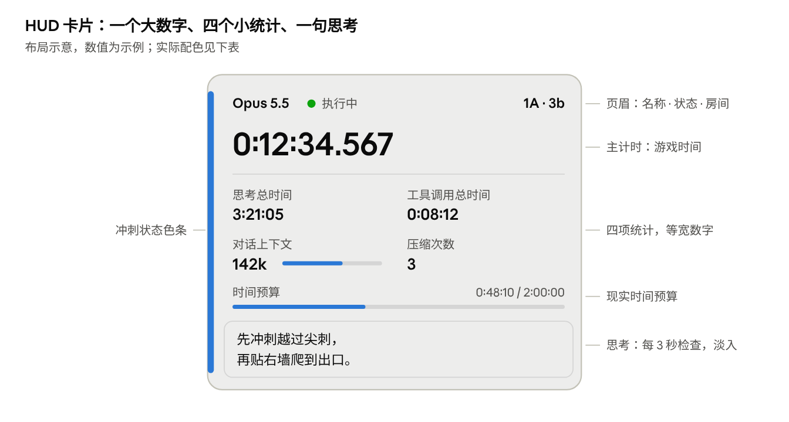

# Celeste\_AI\_Play 项目整体框架与实现原理

> 导出自项目设计文档，更新于 2026-10-23。项目尚未完成，内容会随开发迭代。

## 1. 目标与约束

本项目让多个大模型智能体各用一个新存档，以"暂停—思考—推进若干帧—再暂停"的方式游玩蔚蓝官方章节，OBS 只录下真正推进的游玩帧。整个系统围绕一个核心事实设计：游戏只认"帧"，智能体的思考时间完全发生在帧与帧之间。

### 需求与设计落点

| 需求 | 设计落点 | 章节 |
| --- | --- | --- |
| 多个智能体（Opus 5.5、Fable 5.1 等）各用自己的新档 | 模型适配层提供统一接口；存档守卫校验存档名与槽位 | 3、5 |
| 沙箱独立，不得联网搜索 | 官方 Claude Code 整体运行在出站受限的 Docker 容器里，用 Max 套餐登录；禁用联网工具，Bash 无网络 | 5、12 |
| 每帧接收截图、碰撞箱、Madeline 状态 | 桥接 Mod 每帧采集；决策帧附截图，其余帧给逐帧状态轨迹 | 3、4 |
| 每帧输出按键，思考语句隔几秒一次 | 计划逐帧展开为按键；思考按计划段产出，HUD 默认每 3 秒刷新 | 4、6 |
| 可预置游戏物理参数与机制 | 离线从游戏程序集提取，人工审核后只读挂载进沙箱 | 5 |
| 以尽可能短的游戏内计时通关、多用高级技巧（现实时间放宽，最初设想为：从正式存档进入序章起，2 小时内至少通关 1A 与 2A） | 三层控制：大模型做房间级规划，自写程序做寻路搜索，执行器全速执行 | 5、11 |
| 鼓励使用寻路、搜索算法或自写程序 | 沙箱提供可写工作区与程序运行工具，act 可直接执行程序生成的计划 | 5、11 |
| 剧情能跳过就跳过 | 桥接 Mod 调用游戏自带的"跳过剧情"，对话框自动确认 | 3 |
| 逐帧暂停整个游戏进程 | 帧闸门挂接游戏主循环，未放行时不执行逻辑更新 | 3 |
| 右上角置顶半透明、美观的信息窗口 | 独立 HUD 进程，点击穿透、跟随游戏窗口；单独的视觉规范 | 6 |
| OBS 只录游玩帧的视频与音频 | 已选定方案 B：OBS 插件与游戏帧锁步 + 录制闸门 + 音频随帧冻结 | 7 |
| 预置一个由完整游戏代码搭建、逐帧精确的模拟器，按开关放进沙箱 | 本机反编译搭建（不入库），校准用例逐帧对照；--sim 只读挂进容器 | 13 |

### 术语约定

- **游玩帧**：游戏逻辑实际推进的一帧，对应 1/60 秒游戏时间。
- **决策点**：游戏处于冻结、等待智能体给出下一段按键的时刻。
- **动作块**：一次决策给出的连续 N 帧按键加一句思考，N 可以是 1。
- **可控态**：Madeline 可被玩家操作的状态，不含剧情、死亡动画、房间转场与菜单。

### 设计原则

1. **时间以帧为准**：游戏时间、录像时间轴都按游玩帧计；真实世界的思考与工具时间只进统计，不进游戏。
2. **现实时间是总成本**：通关耗时 = 游玩时间 + 思考时间 + 工具时间。设计上优先减少大模型的决策次数，把重复劳动交给程序。
3. **主控是唯一桥梁**：智能体看到和做出的一切都经过主控，并逐帧落盘，可审计、可回放。
4. **录像可对账**：录像帧数必须等于游玩帧数，这是录制功能的验收标准。
5. **公平可复现**：所有智能体使用同一套提示词、工具、知识库与观测配置，并固定游戏与 Mod 版本。

## 2. 总体架构

系统由宿主机上的四个组件、一个运行智能体的 Docker 容器和外部模型服务组成。主控是唯一同时连着游戏、智能体、HUD 与 OBS 的组件，智能体只能通过它碰到游戏。

智能体就是容器里运行的官方 Claude Code（第 12 节）。它通过 MCP 调用主控提供的游戏工具，主控从它的 stream-json 输出里读取计时、token 与压缩事件；录制时由 OBS 插件按节拍逐帧放行游戏。

| 连接 | 通道 | 传递内容 |
| --- | --- | --- |
| 主控 ⇄ 桥接 Mod | 本机命名管道或 TCP | 观测、推进指令、自动推进、跳过剧情 |
| 锁步插件 → 桥接 Mod | 独立的本机低延迟通道，不经主控以少一跳 | 每个节拍一个"放行 1 帧"令牌 |
| 桥接 Mod → OBS | 游戏捕获与应用音频捕获（精确模式下走共享缓冲） | 画面与声音 |
| 主控 → 锁步插件 | 本机通道；开始与停止录制可走 obs-websocket | 动作块帧数、录制开关 |
| 主控 → HUD | 本机 WebSocket | 各项指标与当前思考 |
| Claude Code ⇄ 主控 | MCP（HTTP，宿主机上的固定端口） | act、observe、recall\_frame、set\_effort 等游戏工具 |
| Claude Code → 主控 | 进程标准输出（stream-json，主控用 docker exec 启动） | token 用量、工具调用起止、压缩事件、会话 ID |
| Claude Code ⇄ 工作区 | 容器内文件系统；Bash 在无网络沙箱中运行 | 自写程序、计划文件、笔记、只读知识库 |
| Claude Code ⇄ 模型服务 | HTTPS，经容器防火墙放行 | 推理请求与响应 |

## 3. 游戏侧：桥接 Mod（CelesteAI.Bridge）

所有"碰游戏"的能力都集中在一个运行于游戏进程内的 Everest Mod 里，它是唯一能读写游戏内存的组件，智能体永远接触不到它。

蔚蓝是 C#/.NET 游戏，Everest 是社区标准的 Mod 加载器（用 Olympus 安装），允许 Mod 以钩子方式挂接游戏的任意方法。TAS 社区的 CelesteTAS 已在同样的环境中实现了逐帧推进、输入回放与碰撞箱显示，并在 Everest 下做到了长时间确定性回放。本 Mod 的帧闸门与输入注入参考其做法，第 7 节的回放渲染可直接复用它。

### 3.1 帧闸门：逐帧暂停的原理

- **挂接点**：挂接引擎主循环的逻辑更新入口（Monocle 引擎的 Update）。闸门关闭时跳过原逻辑更新，但照常处理窗口消息并重绘最后一帧，窗口不会"未响应"。
- **为什么暂停不影响游戏**：蔚蓝以固定步长每秒 60 帧运行，每次逻辑更新恰好推进 1/60 秒游戏时间。暂停多久，游戏内计时、物理与动画都感知不到。
- **放行**：主控下发"推进 N 帧 + 逐帧按键表"。每放行一帧依次执行：写入该帧按键 → 执行原逻辑更新 → 渲染 → 采集状态与画面 → 回报。N 帧走完或触发截断条件即自动关闸。
- **录制锁步**：录制开启时，每一帧的放行还要等 OBS 插件发来的"节拍令牌"，保证一个 OBS 视频帧恰好对应一个游玩帧（第 7 节）。
- **防干扰**：智能体游玩期间屏蔽真实键盘与手柄输入；屏蔽失焦时可能触发的自动暂停菜单等行为（开发时实测确认）。

### 3.2 输入注入

- **注入点**：写在最底层的原始输入状态上（键盘/手柄状态），早于游戏读取输入。游戏自带的按下沿检测、跳跃缓冲、土狼时间等逻辑原样生效，帧级行为与真人按键一致。
- **按键词表**：方向 L/R/U/D，跳 J，冲刺 X，蹲冲 Z，抓 G，交互 T；K、Y、V 是第二个跳、冲刺、蹲冲键。同一动作绑两个手柄按键，按住一个时按下另一个也算新的按下，相邻两帧可以各跳一次，与真人的双键绑定一致。羽毛等需要摇杆角度的场合，可附带模拟角度参数。
- **菜单键**（确认、返回、暂停）只开放给主控的自动流程，不开放给智能体。

### 3.3 状态提取（每帧）

| 类别 | 字段 | 说明 |
| --- | --- | --- |
| Madeline 运动 | 位置（含亚像素）、速度、朝向 | 统一用房间坐标，单位像素 |
| Madeline 状态 | 状态机状态名（普通、攀爬、冲刺、泡泡、羽毛、梦境冲刺等）、剩余冲刺数、体力、是否着地、是否贴墙、是否下蹲、手持物 | 直接读游戏字段 |
| 内部计时器 | 冲刺冷却、土狼时间余量、可变跳跃剩余时间 | 真人看不到这些数值，作为公平性开关（第 8 节） |
| 碰撞几何 | 视野内地形网格（8 像素一格）；每个实体的类型、碰撞箱（矩形/圆）、朝向、语义标签（致死、可站立、可交互、可收集、移动中） | 只报可见物体，不报隐藏触发器 |
| 关卡上下文 | 章节与面（A/B/C）、房间名、房间边界、相机位置、检查点、死亡数 | 房间名同时供 HUD 使用 |
| 时间 | 章节计时、存档总计时、全局帧号 | 游戏时间以帧为准 |
| 事件 | 死亡（及致死实体）、换房、拾取、冲刺补充、落地、触墙 | 供事件截断与观测摘要 |

给智能体的几何信息同时提供两种形式：精确的数值清单，以及视野内 40×23 格的字符地图（如 `#` 地形、`^` 尖刺、`M` Madeline）。状态统一在每帧逻辑更新结束时采样；TAS 社区已发现部分危险物用上一帧的碰撞箱判定，这类时序细节写进知识库，而不是在观测里"修正"。

### 3.4 画面截取

- 游戏画面原生 320×180 像素，先渲染到离屏缓冲再放大到窗口。Mod 在每帧绘制结束后回读这层画面，数据量很小，每帧开销可忽略。
- 发给智能体时用最近邻放大到 640×360，像素边界保持锐利，单张约数百 token。
- 可选附加一张"碰撞箱叠加图"，作为实验开关。
- 只在决策点附图，动作块内的中间帧用状态轨迹代替（第 4 节）。

### 3.5 剧情跳过与非可控段

| 场景 | 处理方式 |
| --- | --- |
| 可跳过的剧情（暂停菜单里会出现"跳过剧情"的段落） | 检测到剧情开始即调用游戏自带的跳过逻辑，等同于玩家在菜单里选"跳过" |
| 不可跳过的对话框 | 自动注入确认键逐句推进 |
| 无需操作的过场：重生动画、房间转场、章节开场明信片、收集动画、章节结算 | 主控自动推进帧，不唤醒智能体 |
| 主菜单、选档、大地图选章 | 主控用固定宏导航，不计入智能体操作 |

只有同时满足以下条件才唤醒智能体：场景是关卡、Madeline 存在且未死亡、不在剧情中、处于玩家可控状态、没有对话框。每次自动跳过都作为"系统事件"写入帧日志，回放时在同一帧重放。

### 3.6 存档守卫

- 三类存档：opus5.5、fable5.1 是正式存档，只用于正式挑战；test 存档专用于调试与工具准备，不计成绩，可随时重置。
- 开局前校验当前存档名与槽位是否与配置一致（如 opus5.5 对应某个固定槽位），不一致拒绝启动。
- 每次运行开跑前，主控把当前存档的全部文件（N.celeste 与 Everest 的 N-\*.celeste）复制到本次运行目录的 save\_backup/，作为复现与回放的起点。实验期间建议关闭该游戏的 Steam 云同步，避免存档被覆盖。
- 校准用的 load\_room、teleport 只在 test 存档上可用；彩排正式流程时用 calibration/reset\_test\_save.py 把 test 存档重置成正式存档的初始进度（只读正式存档）。
- 辅助模式与变体保持关闭；游戏、Everest、Mod 的版本号写入每次运行记录。

### 3.7 与主控的通信

Mod 内置一个只监听本机的 IPC 服务端（命名管道或 127.0.0.1 上的 TCP），只接受主控连接。指令集很小：握手与版本、取观测、推进 N 帧（附按键表与截断条件）、自动推进、跳过剧情、菜单宏、锁步开关。

## 4. 主控与决策循环

主控（Orchestrator）是运行在本机的受信任常驻进程，同时连着游戏、智能体运行时、HUD 和 OBS。智能体每做一次决策，主控就完成一轮"观测 → 决策 → 推进 → 回报"。

正式运行默认采用第 11 节的分层模式：大模型每个房间只决策一两次，按键由它自写的规划程序生成。本节的逐帧循环是底层机制，同时保留为调试模式。

### 4.1 一轮决策的时序

1. 游戏冻结在第 F 帧，桥接 Mod 回报该帧的完整观测。
2. 主控组装观测消息：决策帧截图、当前状态、上一动作块的逐帧轨迹、期间发生的事件。
3. 发给智能体运行时，开始累计"思考时间"；智能体期间调用沙箱工具的耗时计入"工具时间"。
4. 智能体提交动作块：未来 N 帧的按键表、一句思考，可附截断条件。
5. 主控校验动作块（格式、键名、N 不超上限、思考长度）。不合法就退回重写，不消耗任何游戏帧。
6. 主控把思考语句推给 HUD，打开录制闸门，令 Mod 在锁步下推进 N 帧，每帧回报状态。
7. 动作块走完或被截断后关闭录制闸门，游戏冻结在新的一帧，回到第 1 步。

非可控段（第 3.5 节）由主控自动推进，不进入这个循环。

### 4.2 动作块如何满足"每帧输出"

- **按键逐帧**：动作块里每一帧都有明确按键，落盘时逐帧展开。按键可以由智能体直接写出，也可以由它自己的规划程序生成（第 11 节）。
- **思考隔几秒一次**：思考语句不必逐帧产出，每个动作块或路线段附一两句即可。HUD 默认每 3 秒检查一次，有新语句才替换；落盘时每帧记录当时生效的那一句。
- **写法**：按键表沿用 TAS 社区的"帧数 + 按键"写法，例如"6 帧 R；1 帧 R+J；10 帧 R；1 帧 R+U+X"。
- **长度**：逐帧调试模式下建议上限 60 帧；分层模式下一份计划可以覆盖整个房间，由执行器的偏差监控兜底。

### 4.3 事件截断

- **强制截断**：死亡、换房、进入非可控态。发生即停，剩余按键作废并在日志中标明。
- **自选截断**：智能体可声明"落地即停""贴墙即停""冲刺次数恢复即停"等条件，由主控按状态判定。这样一个动作块可以覆盖"不知道要飞几帧"的跳跃，又不会盲按。

### 4.4 观测粒度：为什么不是每帧一张图

- 决策帧一张 640×360 截图约几百 token。若 60 帧的块里每帧都附图，一次观测就多出上万 token，上下文很快耗尽。
- 因此块内中间帧用紧凑的逐帧状态表代替（帧号、坐标、速度、状态、冲刺数、是否着地），比截图更精确；截图只在决策帧给出。
- 需要严格"每帧一图"时把 N 设为 1 即可，代价是决策次数与费用随帧数线性增长。

### 4.5 统计口径

| 指标 | 口径 | 来源 |
| --- | --- | --- |
| 当前游戏时间 | 存档内的章节计时（另附存档总计时），按游玩帧累计 | 桥接 Mod |
| 智能体思考总时间 | 一轮之中没有工具在运行的墙钟时间之和（模型推理、输出、上下文压缩），主控给输出流事件打时间戳计算 | Claude Code 输出流 |
| 工具调用总时间 | 容器内工具与游戏工具从调用（输出流的 tool_use）到返回（tool_result）的时间，几个工具同时运行只算一份；act 的游戏推进耗时单独统计，不计入；自动重试的重算用时计入 | Claude Code 输出流 |
| 对话上下文大小 | 最近一次请求的输入 token 数（含缓存读写），取自输出流的 usage 字段 | Claude Code 输出流 |
| 上下文压缩次数 | 输出流中压缩事件的累计次数 | Claude Code 输出流 |
| 当前房间 | 章节、面与房间名，如"1A · 房间 3b" | 桥接 Mod |
| 当前思考 | 最近一次 act 携带的思考语句 | 游戏工具 |

这些指标逐帧写入帧日志，录像中 HUD 显示的数值与日志一一对应。

## 5. 智能体运行时与沙箱

智能体是运行在 Docker 容器里的官方 Claude Code，用你的 Max 套餐登录（落地细节见第 12 节）。它能看到什么由主控的观测决定，能做什么由容器里开放的工具决定；对外的通道只有三条：主控的游戏工具、主控读取的输出流、到 Anthropic 模型服务的推理请求。

### 5.1 隔离模型

- **推理不等于联网搜索**：Opus 5.5、Fable 5.1 运行在服务端。容器出站只放行 Anthropic 官方域名与主控端口，推理请求是唯一的外部出站。
- **只开放必要的工具**：Bash、Read、Write、Edit、Glob、Grep，加主控的游戏工具；WebSearch 与 WebFetch 在 root 所有的托管配置里拒绝，智能体改不回来。
- **自写程序无网络**：Bash 命令在 Claude Code 自带的沙箱里运行，网络全部关闭；即使读到登录令牌，也发不出任何请求。
- **看不到游戏**：容器不挂载游戏目录、OBS 目录与存档，看不到宿主进程；知识库只读挂载，工作区可写。
- **智能体之间隔离**：每个存档对应一个容器（opus5.5、fable5.1、test），工作区、笔记与会话互不相通。
- **无法抹除的先验**：模型在训练中可能见过蔚蓝的攻略。沙箱只能保证运行时不获取新信息，分析结果时应注明这一点。

### 5.2 智能体可用的工具

| 工具 | 作用 | 执行位置 | 计时归属 |
| --- | --- | --- | --- |
| act（游戏工具） | 提交按键（直接写出，或引用工作区里的计划文件）、思考语句、截断与偏差条件、重试策略；阻塞到推进完成，返回新观测 | 主控 → 游戏 | 单独统计为推进时间 |
| observe（游戏工具） | 取当前帧的截图、状态与几何，用于每个房间的第一次观察 | 主控 | 工具时间 |
| set\_effort（游戏工具） | 申请调整推理强度（low、medium、high、xhigh、max），本轮结束后主控在同一会话里切换（12.4）；不推进游戏 | 主控 | 耗时可忽略，计入思考时间 |
| recall\_frame（游戏工具，可选） | 取回本局此前某个决策帧的截图或状态 | 主控日志 | 工具时间 |
| Bash | 运行自写程序（模拟器、寻路、搜索），产出计划文件与预期轨迹；在无网络沙箱中执行 | 容器 | 工具时间 |
| Read / Write / Edit / Glob / Grep | 编写和修改程序、查阅只读知识库、维护长期笔记 | 容器 | 工具时间 |

### 5.3 每次观测包含的内容

1. 头部：章节与房间、全局帧号、游戏时间、死亡数。
2. 决策帧截图（640×360），可选碰撞箱叠加图。
3. Madeline 当前状态。
4. 上一动作块的逐帧轨迹表与事件列表；若死亡，附致死实体和死前几帧。
5. 视野内实体清单与字符地图。
6. 上一动作块的思考与按键，帮助智能体保持连贯。

### 5.4 输出约束

- 思考语句 1–2 句，建议不超过 60 个汉字；语言可配置，默认中文，HUD 直接显示。
- 模型的完整推理过程不受这个长度限制，只计入思考时间；HUD 上只显示那一两句总结。

### 5.5 上下文管理与压缩

1. 截图是上下文增长的主因：保持小尺寸（640×360），每个房间通常只取一张。Claude Code 无法单独删掉旧截图，靠自动压缩回收。
2. Claude Code 在接近上下文上限时自动压缩，较早的交互被总结成摘要；压缩阈值可在配置里调整。
3. 主控从输出流的压缩事件计数；若所用版本不输出该事件，就按相邻请求输入 token 的骤降判定。
4. 系统提示词放在固定文件里追加，运行期间保持不变。

长期笔记是压缩的补充：写什么由智能体自己决定，压缩不会抹掉它。

### 5.6 知识库：能预置什么，不能预置什么

知识库在沙箱外离线生成：从游戏程序集中提取 Madeline 的物理常量与状态机规则，经人工审核后写成只读文档。智能体只看到结论文档，看不到代码与提取脚本。判定原则只有一条：**知识库回答"游戏规则是什么"，不回答"这一关怎么过"。**

收录：

- 物理常量：重力、最大下落与奔跑速度、加速度、跳跃初速、冲刺速度与时长、体力消耗，并注明换算（速度 60 = 每帧 1 像素）。
- 机制规则：土狼时间、跳跃缓冲、可变跳跃高度、蹬墙跳、攀爬跳、墙弹，以及超冲、蹭角等技巧的触发条件。
- 判定时序：每帧内的更新顺序、哪些危险物使用上一帧碰撞箱等细节。
- 实体图鉴：每个实体类型名代表什么、碰撞箱语义、交互效果，与观测中的类型名一一对应。
- 输入语义：按键词表与动作块格式。

不收录：

- 章节地图、房间布局、路线与解法、收集品位置、任何文字或视频攻略。

### 5.7 任务目标（写入系统提示词）

- **目标**：在现实时间预算内通关指定章节（硬性要求），并在此基础上让游戏内章节计时尽可能短、多用高级技巧、打出精彩操作，本轮为从序章到 2A。现实时间 = 游玩时间 + 思考时间 + 工具时间，三者同样计入。
- **只求通关**：不收集草莓、磁带与水晶心；能跳过的剧情一律跳过。
- **死亡很便宜**：死亡后会在房间附近很快重生。犹豫的时间比试一次还长时，先试。
- **鼓励自写程序**：根据知识库的物理参数编写模拟器，用寻路（如 A\*）或搜索（如广度优先、束搜索）在房间几何上规划按键序列，再交给 act 执行。
- **程序可复用**：程序跨房间、跨章节复用和改进；改进程序的时间同样计入，值得才做。
- **推理强度**：默认 high；简单房间可以用 set\_effort 下调省时，难房间上调。
- **一个房间一轮**：打完当前房间就结束本轮，下一轮从新房间开始。
- **时间不可见**（2026-10-24 起；之前观测头部附"已用现实时间 / 时间预算"）：预算只是主控的安全上限，不写给智能体看，免得它为赶时间执行没优化完的路线（14.7）。
- **两个版本**（2026-10-24）：开模拟器的版本写明上面这些做法与要求；关模拟器的版本只写目标、规则与工具接口，不教打法（14.7）。

### 5.8 准备阶段：开局先读完知识库

每次运行开始时，智能体先把知识库从头到尾读一遍，再开始游玩；这一段不计入现实用时。

- 第一条消息按顺序列出要读的文件：kb/ 下全部文件，加上 reference/ 里的 Celeste Wiki 技巧页面与草莓酱训练场、机制库的英文原文（中文版是同一内容的翻译，不要求读）。目前共 27 个文件，约 24 万 token。
- 主控从 Claude Code 输出流里 Read 工具的结构化结果（起始行、行数、总行数）逐行核对，不依赖模型自己汇报；长文件被 Read 截断时，截断之后的行不算读过。没读完之前，observe 与 act 只返回"还有哪些文件的哪几行没读"。
- 读完后整理笔记、编写模拟器与规划程序也算准备阶段；第一次成功执行游戏工具时开始计现实用时。准备阶段上限默认 60 分钟（--study-minutes），到时自动开始计时。
- Opus 5.5 与 Fable 5.1 在 Claude Code 里的上下文窗口都是 100 万 token，读完知识库后仍有约 70 万 token 才触发自动压缩。代价是之后每次请求都带着这部分上下文，Max 用量消耗更快。
- 实测（2026-10-22，Opus 5.5，test 存档 1A）：27 个文件并行读完用时 40 秒；随后在准备阶段写出约 40 KB 的逐帧模拟器和一个束搜索程序，准备阶段共 598 秒。

## 6. 右上角置顶半透明 HUD 窗口

HUD 做成一个由主控实时推送数据的本地网页：一份显示在置顶透明窗口里供现场观看，一份作为 OBS 浏览器源进入录像，两边画面一致。

### 6.1 窗口实现原理

- **外壳**：独立进程（overlay/window.py，用 pywebview 承载系统自带的 WebView2），无边框、背景透明；半透明由页面里卡片的底色负责（78% 不透明度），文字保持不透明。HUD 服务（overlay/server.py）由主控在进程内启动，也可以单独运行，总是显示最近一次运行的数据。主控运行时自动打开置顶窗口、结束时关闭；窗口按进程名 Celeste.exe 找游戏窗口。
- **置顶且不打扰游戏**：使用 Windows 分层窗口的扩展样式组合——置顶、点击穿透、不激活（WS\_EX\_TOPMOST、WS\_EX\_LAYERED、WS\_EX\_TRANSPARENT、WS\_EX\_NOACTIVATE），不出现在任务栏，焦点始终留在游戏上。
- **跟随游戏窗口**：订阅游戏窗口的移动与缩放事件，始终贴在游戏客户区右上角，并按 DPI 缩放。
- **前提**：游戏运行在窗口化或无边框全屏模式；独占全屏下任何置顶窗口都盖不上去。

### 6.2 显示内容（数值为示例）

| 区域 | 内容 | 显示示例 |
| --- | --- | --- |
| 页眉 | 智能体名称、运行状态、当前房间 | Opus 5.5 · 执行中 · 1A · 3b |
| 主计时 | 游戏时间（章节计时） | 0:12:34.567 |
| 推理强度 | 主计时右侧：英文档位名与五格刻度；已申请、还没生效时后面跟"→ 目标" | high（三格亮） |
| 统计 | 两列九项：思考、上下文、工具、压缩、知识库读取（开局到读完知识库的用时；之后的准备阶段计入思考与工具）、死亡、模拟器调用、推演路径（这次调用的条数，画完清零）、推演最速（当前房间）；下面一整行"调用工具"：正在调用的工具与说明 | 1:02:03、412k、0:08:12、1、0:01:18、2 次、7 轮、18 次、1.2万 条、2.383s；Bash · 看看先上左边的墙 |
| 思考 | 当前思考语句，字号最大的文字，最多五行（再长缩小一档，最多六行） | 先 climbjump 上墙，再 wallbounce 越过尖刺。 |

### 6.3 刷新节奏与录像同步

- **思考期间**：计时器持续走动（每秒约 10 次刷新），状态标签显示"思考中"并缓慢呼吸闪烁。
- **执行期间**：游戏时间逐帧走动（桥接在执行中每 6 帧推送一次章节计时、冲刺次数与房间，页面在两次推送之间按实时外推）；思考语句一有新的就淡入替换：主控在每段动作推进之前先写出新语句、等约 0.4 秒让 HUD 换好再放行（游戏冻结着，录像里不占时间），所以新语句与这段动作的第一帧同时出现。早先的做法是每 3 秒检查一次，实测常常动作做完、进了下一个房间才换上，已改掉。
- **录像里**：思考期间被剪掉，计时器会在决策之间"跳一下"，跳幅就是这次决策花的时间，这是期望效果。
- **严格同帧**：浏览器源有 1–2 帧渲染延迟。若要求 HUD 与画面逐帧严格对应，改由第 7 节的 OBS 插件在同一节拍里直接绘制 HUD 文字。

### 6.4 视觉设计规范

HUD 采用"一个大数字、十个安静的小统计、一句醒目的思考"的深色卡片（主计时右侧附推理强度），主题色跟随 Madeline 的冲刺状态，在雪地等亮场景上也清晰可读。2026-10-23 晚改版：收窄到游戏宽度的约 18%，去掉进度条与思考框底色，思考语句加大，数字改用半窄体。

卡片以主计时为视觉中心，其余信息按读取频率由上到下排列。

| 要素 | 规范 |
| --- | --- |
| 尺寸与位置 | 页面宽约为游戏窗口宽度的 18%（1080p 下 350 像素），距右上角 2%，随窗口等比缩放 |
| 卡片 | 深夜蓝底 #101322，不透明度 80%；圆角 12 px（以 1080p 计）；1 px 描边为 10% 白；轻微外阴影；内部只用两条细线分隔计时、统计与思考 |
| 字体 | 中文 Noto Sans SC；数字与英文档位用半窄体 Barlow Semi Condensed（Windows 上缺字体时退到 Bahnschrift）并开启等宽数字，数值变化时不抖动、窄卡片也放得下；不使用游戏自带字体资源 |
| 层级 | 主计时 36 px（毫秒位小一号）；页眉 15 px；统计数值 16 px、标签 13 px 灰色；思考语句 17 px，最多五行（再长时 15 px、最多六行）；1080p 下页面区域 350×508（"调用工具"一行放不下时折行、最多三行） |
| 主题色 | 左侧色条与状态点跟随冲刺状态：有一次冲刺绯红 #E0475B，冲刺用尽冰蓝 #5BC0EB，两次冲刺粉色 #F28AC4，对应游戏里 Madeline 的发色 |
| 状态标签 | 思考中为琥珀色呼吸点，运行工具（智能体在跑自己的程序、读写文件）为紫色呼吸点 #9D8CF2，执行中为绿色，自动重试为橙色，等待为灰色 |
| 推理强度 | 主计时右侧：12 px 灰色标签"推理强度"，下面是由矮到高的五格刻度与英文档位名（low、medium、high、xhigh、max）；low 至 high 为蓝色 #7FA6F5，xhigh 与 max 为琥珀色 #F5B841；已申请未生效时在后面加琥珀色、呼吸闪烁的"→ 目标档位" |
| 上下文 | 只显示数值；达到压缩阈值的 90% 时变橙。现实用时不再显示（2026-10-23 按要求去掉，时间预算照常生效） |
| 动效 | 思考语句 200 ms 淡入；数值不做滚动动画。动效在录像中同样可见，保持克制 |
| 可读性 | 文字对比度不低于 4.5:1；文字带 1 px 暗色投影 |
| 实现 | 一份 HTML/CSS 页面，同时用于置顶窗口和 OBS 浏览器源；配色与尺寸放在配置文件里 |

## 7. OBS 只录游玩帧

推荐自研一个 OBS 插件，让 OBS 的视频节拍成为游戏推进的时钟：录制时每个 OBS 视频帧恰好放行一个游玩帧，思考期间录制处于暂停态，音频随游戏一起冻结。验收标准是录像帧数等于游玩帧数，且帧号连续无重复。

**已选定方案 B 作为正式录制方式。** 方案 C 只作为录制出故障时的补救手段保留。

### 7.1 难点在哪里

- OBS 按真实时钟以固定帧率采集；而游戏绝大部分时间处于冻结状态，冻结时窗口仍在显示同一帧。
- 单纯按秒去剪，边界处会多录或漏录几帧。单帧推进时一段只有 16.7 毫秒，遥控指令的往返与采集延迟就足以把它录成 0 帧或 3 帧。
- 蔚蓝的声音由 FMOD 在独立线程里实时混音。游戏逻辑冻结后，音乐和环境声仍在播放，必须单独冻结。

### 7.2 三档方案

| 方案 | 做法 | 精度 | 工作量 | 定位 |
| --- | --- | --- | --- | --- |
| A. 遥控暂停 | 主控通过 OBS 自带的 obs-websocket（v5 协议）发送 PauseRecord / ResumeRecord，夹住每个动作块 | 每段边界有帧级误差，单帧推进基本不可用 | 低，无需插件 | 原型验证 |
| B. 锁步插件（已选定） | 自研 OBS 插件：用 OBS 视频节拍放行游戏帧，在 OBS 进程内按帧边界暂停与恢复录制，音频随帧冻结 | 视频逐帧精确，音频见 7.4 | 中 | 正式录制 |
| C. 回放渲染 | 游玩时记录逐帧按键与系统事件，结束后从备份存档起确定性重放，OBS 连续录制 | 音视频完全连贯 | 低，日志已有 | 故障补救 |

### 7.3 方案 B：锁步插件原理

1. **节拍时钟**：插件注册 OBS 的每帧回调（在渲染这一帧之前执行），录制期间每个节拍经桥接的第二个本机端口（47776）发一个令牌，最多等 10 毫秒。桥接收到令牌才推进一帧，等这一帧呈现到屏幕后回复帧号与章节计时；没有要推进的帧时立即回复"无"。锁步期间游戏循环改为不限速、关闭垂直同步，节奏完全由 OBS 决定，所以动作块按 60 fps 实时播放。
2. **保证 OBS 采到的就是这一帧**：桥接在呈现之后读回一个 1×1 渲染目标，等显卡把这一帧做完再回复（不能读后备缓冲：FNA3D 每次读后备缓冲都会泄漏一块整屏大小的暂存纹理，每帧约 8 MB）；停住的节拍不重画，推进前保证离上一次呈现超过 9 毫秒。原因是 OBS 游戏采集的钩子最多每 1/120 秒拷贝一次画面，停住时频繁重画会占掉拷贝机会，实测约一半的帧会被采成上一帧。
3. **只录游玩帧**：不用 OBS 自带录制的暂停接口（它按系统时钟取最近的帧，不能精确到帧），而是插件自带一个原始画面输出：OBS 每渲染一帧都交给它，它只把"这一节拍刚推进了一个游戏帧"的那些帧经管道交给 ffmpeg 编码，其余直接丢弃。成片的帧数因此等于游玩帧数，思考时间在成片里不存在。
4. **画面来源**：OBS 自带的游戏采集（共享纹理），画布与游戏窗口同为 1920×1080，HUD 是同一场景里的浏览器源。
5. **对账**：每个成片帧记一行（成片序号、游戏帧号、章节计时、OBS 时间戳）到 frames.csv；结束时检查游戏帧号连续。校准时桥接在画面左下角画 16 格帧号条码，从录像里逐帧解码，与 frames.csv 逐帧比对。
6. **控制与状态**：主控经桥接把"开始 / 停止录制"转给插件；插件每秒报告状态（录制中、收尾中、已完成、失败、帧数），主控通过桥接的 hello 读取，停止后等 ffmpeg 收尾并合成 gameplay.mkv。

### 7.4 音频：让声音也只在游玩帧里流动

- **冻结**：游戏停住超过 60 毫秒，桥接暂停 FMOD 的主总线（声音位置冻结，设备输出静音）；一推进就恢复。OBS 用"应用音频捕获"只抓 Celeste.exe，没有桌面音频和麦克风。
- **只取游玩帧的声音**：插件把采到的声音按时间戳缓存，每个成片帧取对应的 1/60 秒（48 kHz 下 800 个样本）写进 WAV，所以声音长度严格等于帧数 × 800。
- **按段自校准**：采集管线的延迟不是常数——实测 110～170 毫秒，而且 OBS 会在录制中途增加音频缓冲，使延迟突然变化约 70 毫秒。插件利用冻结造成的特征：每段动作开头，声音从完全静音（采样值为 0）恢复，这条边就是这一刻的延迟。两个成片帧相隔超过 100 毫秒算新的一段，插件在预计位置前后 250 毫秒内找"至少 5 毫秒静音之后第一个有声样本"，取最近 5 次的中位数作为这一段的偏移；找不到时沿用上一次。桥接在这一段第一帧推进之前恢复声音（指令在第一帧的 Audio.Update 里生效），所以边对齐到第一帧开头；桥接 0.11.3 之前在第一帧推进之后才恢复，边对齐到第二帧，每段开头有一帧静音。各段的量值写进 segments.csv。
- **暂停与继续之间的接缝**（2026-10-23 晚）：原来游戏停住 60 毫秒后才暂停声音，这 60 毫秒里放出的音乐没有对应的帧、不进录像，下一段从暂停处接着放，再加上每段开头一帧静音，接缝处的音乐会跳一下。桥接 0.11.3 起录制时在停住后的第一个节拍（回复 N 的那个令牌）、在这个节拍的 Audio.Update 之前暂停，正好在上一帧的 1/60 秒结束时生效；推进（包括规划回放的帧）之前恢复。插件对相隔一个节拍以上的两个成片帧，前一帧结尾淡出 2 毫秒、后一帧开头淡入 2 毫秒（前一帧已写进 WAV 时回到它的位置重写），只去掉波形突变的爆音，音乐内容是接上的；每段量到的延迟与中位数相差不超过 20 毫秒时直接用这一段自己的值（混音按块生效，每段差几毫秒）。剩下的误差来自 FMOD 混音按块生效（约十几毫秒以内）。
- **暂停晚一个节拍**（2026-10-24，桥接 0.11.4）：DeepSeek 短测的录像（142 个接缝）里每段开头已没有静音，但约四分之一的接缝，前一段最后一帧的末尾有 3～19 毫秒的静音：在第一个空闲节拍暂停时，暂停正好卡在上一帧那 1/60 秒的末尾，FMOD 按混音块生效的时刻有十几毫秒的抖动，经常截掉上一帧的最后一截音乐，听起来是细小的断口。现在停住后的第二个空闲节拍才暂停（约晚 1/60 秒），上一帧的音乐总能完整放出；代价是这多放的约一帧长度的音乐不进录像，下一段从暂停处接着放，接缝处音乐向前跳约 17 毫秒，两边各有 2 毫秒淡出淡入，听不出来。M6 测试加了一项：每段动作最后一帧末尾的静音不超过 3 毫秒（插件淡出 2 毫秒）。
- **音频块边界的单样本断口**（2026-10-24）：OBS 每次交给插件 1024 个样本的音频块，插件按每个成片帧的时间戳去块里取 800 个样本。原来判断"第 k 个输出样本归哪一块"用向上取整，算块内位置用四舍五入，两者不一致：帧时间与样本之间的小数错位落在 (0, 0.5) 时，每个块边界上有一个样本两块都不取、留成 0，即每 1024 个样本一个 0（约每秒 47 次）。错位只取决于每段量到的延迟，所以约一半的段整段都有、另一半完全没有，与接缝无关，连续游玩时听起来是持续的电流声（用户在 10-23 Fable 正式运行的录像里发现；那一份 16 段里 11 段有，10-24 的 DeepSeek 录像几乎每段都有）。现在块的范围与块内位置按同一种舍入算（k ∈ [ceil(u − 0.5), ceil(u + 1024 − 0.5))，idx = floor(k − u + 0.5)），相邻两块首尾衔接；块时间戳按纳秒取整偶尔漏掉的单个样本用相邻样本补上。离线模拟 8 万帧：原来 31768 个空样本，现在 4 个（都被补上）。M6 测试加了一项：WAV 里不该有单个样本的断口。
- **精度**：FMOD 按混音块出声，单次量值有 ±10 毫秒左右的抖动，取中位数后整体对齐误差在几毫秒内；这一量级与原版游戏里按键到出声的抖动相同。
- **独立游戏音频与两条音轨**（协作者的 game\_nrt，现为默认；双音轨为桥接 0.12.7）：上面的对齐都是 OBS 混音（obs\_mix）的做法。game\_nrt 不经过声卡和 OBS 混音：桥接另开 FMOD Studio 系统（NOSOUND\_NRT、同步更新），镜像游戏音频事件的开始、停止、释放、cue、定位与每帧的参数、音量、总线与 VCA 状态，每推进一次正好混出 800 个样本，放进共享内存，插件按时钟令牌取用，与墙钟无关。原来只有一个镜像系统、只随真实游玩帧推进，回放帧写静音：纯享版的音乐连贯，完整版每段回放都是一段静音。现在开两个镜像系统（用户要求两个版本都连贯）：
  - 完整版音轨（audio.wav，合进 gameplay.mkv）：每个成片帧都推进。真实游玩帧照常混；回放帧里照抄游戏此刻的总线状态（音效、界面音效与 stings 暂停，只放音乐和环境声），所以回放期间音乐继续，回放结束接上真实执行。
  - 纯享版音轨（audio\_play.wav）：只随真实游玩帧推进，与原来的单音轨相同。纯享版去掉回放帧以后直接用它，不再从完整版裁剪、不再有接缝淡入淡出。
  - 两条音轨的音乐在第一次回放之后就不同步（完整版多放了回放那几秒），这是两个版本都连贯的必然结果；带随机变化的音效（脚步声等）在两个系统里各自抽取，可能不是同一个变体。
  - 共享内存升为第 2 版：每槽一个令牌、错误标志、回放标志（与插件收到的章节计时 -1 互相核对），后接两段 800×2 浮点。两端分别报告 hello.record\_audio\_tracks 与插件状态 audio\_tracks，都为 2 才开始录制，旧版本明确拒绝。
  - 插件在 game\_nrt 下不再给跟不上节拍的回放帧补帧：声音按帧生成，补帧只能把同一块 1/60 秒重复一遍（听起来是嗡嗡声）；回放的长度就是画出的帧数，也正好符合每轮回放最长 1.5 秒的限制。某一帧没有新混出的块时写静音，绝不重复旧块。
  - 流式音乐由混音更新驱动（STREAM\_FROM\_UPDATE、LOAD\_FROM\_UPDATE），不用 FMOD 的后台流线程：镜像系统按成片帧推进，与墙钟无关，后台线程按墙钟读流时可能供不上（音乐断续），两个系统的输出也会不一样（原生自检里同样的真实帧，两条音轨能量相差 25%）；改成由更新驱动后输出确定，两条音轨在真实帧上逐样本相同。录制开始时正在播放的音乐要约 10 帧（约 0.17 秒，FMOD 流式声音的调度延迟）才能定位进流里出声，只发生在录像开头。（test 存档联合验收时完整版开头的回放帧有 61 帧静音，查下来是序章音乐开头约 2 秒的安静前奏：刚进关卡时直播音乐才走到 0.9 秒，不是混音的问题。）
  - 总线暂停按调用镜像（钩住 Bus.setPaused，与事件的开始、停止一样），不再每帧读游戏的 getPaused：游戏的 FMOD 系统是异步的，getPaused 返回它上一次处理完的状态，桥接在这一节拍刚恢复的主总线与音效总线还读成暂停，镜像就把这一帧整块混成静音——每段规划回放之后的第一个真实帧都是静音（0.12.6 的单音轨录像里也有，只是夹在静音的回放帧旁边听不出来）。
  - 代价：多一份 bank 与样本数据的内存（几百 MB 以内），每个游玩帧多一次 800 样本的混音（远不到 1 毫秒）。

### 7.5 方案 C：回放渲染为什么可行

- 蔚蓝在相同起点、相同逐帧输入下结果确定。TAS 社区用 CelesteTAS 配合 Everest 回放了游戏内时间约 1 小时 17 分钟的全收集 TAS，Everest 还帮他们规避了线程导致的失步。
- 主控本来就逐帧记录按键与"跳过剧情"等系统事件，可直接导出为回放文件。结束后恢复备份存档，以 60 fps 正常速度重放，OBS 连续录制，HUD 按帧号从日志驱动。
- 回放时逐帧比对 Madeline 坐标与原日志，不一致即报失步。
- 这是对真实游玩的忠实重演而非现场录制，建议作为方案 B 的保底，或用于制作高质量成片，并在成片说明中注明。

### 7.6 OBS 设置要点

- **专用配置**：`tools/obs_setup.py` 在 OBS 的配置目录里建专用的配置文件与场景集合 CelesteAI（画布与输出 1920×1080、60 fps、NV12、Rec.709 有限范围，48 kHz 立体声；场景含游戏采集、应用音频捕获、HUD 浏览器源），用户自己的配置文件与场景不动；启动时记下原来选中的配置，关闭时还原。
- **启动方式**：OBS 32 已没有关闭崩溃检查的参数，上次没有正常退出时会弹安全模式对话框（安全模式不加载插件）：脚本在 OBS 没在运行时清掉过时的崩溃标记再启动，并让 OBS 进程独立于启动它的终端。
- **编码**：ffmpeg 参数可配置；本机用 NVENC（`h264_nvenc -preset p5 -tune hq -rc constqp -qp 16`），默认用 libx264。画面与声音先分别写 video.mkv 与 audio.wav，结束后合成 gameplay.mkv（AAC 256 kbps）。
- **游戏窗口不能最小化**：最小化时 FNA 把交换链缩到 8×8 像素，游戏采集只能采到一块深色小方块（2026-10-23 试跑时遇到）。主控在开始录制前、以及录制中每次推进游戏前检查 Celeste 窗口，最小化了就用"显示但不激活"的方式还原；被别的窗口挡住不影响采集。
- **构建**：插件是一个 C 文件，用 pip 安装的 zig 交叉编译，libobs 头文件按本机 OBS 版本从官方仓库取，不需要 Visual Studio（`tools/build_obs_plugin.py`）。插件与 OBS 版本强绑定，OBS 更新后需重新编译并跑一遍校准测试。

### 7.7 实测结论（M6，2026-10-23）

- 校准测试 `calibration/m6_recording_test.py`（40 轮"停 0.7 秒 → 推进约 1 秒"，共 2219 帧）：成片帧数与游玩帧数一致，游戏帧号连续，2219 帧画面里的帧号条码与记录逐帧一致；WAV 长度正好是帧数 × 800。
- 修正前的两个问题：约一半的帧采到上一帧（游戏采集钩子的拷贝间隔，见 7.3 第 2 条）；声音延迟在录制中途跳变约 70 毫秒（OBS 增加音频缓冲，见 7.4）。修正后 40 段全部量到延迟，对齐误差中位数 0 毫秒，最大 12.7 毫秒，不到一帧。
- 锁步期间约 5% 的节拍等不到回复（游戏一帧偶尔超过 10 毫秒），这些节拍顺延到下一拍，不影响成片，只让动作块的现场播放略慢于 60 fps。

游戏进程内存：读后备缓冲的版本录一阵就涨到 60 GB；改读 1×1 渲染目标后，录 2219 帧只增长约 30 MB，画面仍逐帧一致；完全不等显卡时约 2% 的帧采到上一帧。

## 8. 公平性、可复现与数据产出

每次运行都要能回答三个问题：智能体看到了什么、做了什么、花了多少。为此观测配置统一、版本固定、一切落盘。

### 8.1 公平性开关

| 开关 | 建议默认 | 说明 |
| --- | --- | --- |
| 几何观测范围 | 相机画面加少量边距 | 真人只能看到屏幕；提供整个房间几何作为对照实验选项 |
| 内部计时器（土狼时间余量等） | 提供 | 属于 Madeline 状态，但真人看不到，可关闭做对照 |
| 隐藏触发器、屏幕外实体 | 不提供 | 真人无法感知的信息一律不给 |
| 碰撞箱叠加图 | 不提供 | 调试用 |
| 决策截图分辨率 | 640×360 | 所有智能体相同 |
| run 程序工具与工作区 | 提供 | 鼓励使用；可关闭，对照"只靠大模型"的表现 |
| 试跑与读档工具 | 不提供 | 让真实游戏替智能体验证路线等于 TAS 式读档试错，违背"只玩一遍"；如需要，单列为辅助模式对照组 |
| 模型推理强度 | 默认 high，允许动态调整 | 两个智能体使用同一套调整规则，每次决策的强度写入日志 |
| 游戏画面选项（屏幕震动等） | 全部统一 | 影响截图观感 |
| 预置模拟器（默认开，--no-sim 关） | 开启（正式挑战用这个版本） | 只读挂进容器的逐帧精确模拟器（13.1），只做预测、不在游戏里试错；开关把项目分成两个版本，提示词各一套（14.7）：开时智能体随意调用模拟器寻找并优化路线，关时智能体不能调用模拟器、提示词不教打法，只靠自己的办法 |

### 8.2 版本固定

每次运行记录并固定：游戏版本、Everest 版本、桥接 Mod 版本、OBS 与插件版本、模型名与推理参数、提示词与知识库的哈希。任何一项变化都视为新的实验条件。

### 8.3 每次运行的产出

存放在 `runs/<智能体>/<时间戳>/` 下，据此可统计每个房间的死亡数、游玩帧数、决策次数与思考时间，并在智能体之间对比。

| 文件 | 内容 |
| --- | --- |
| frames.jsonl | 每个游玩帧一行：帧号、房间、按键、所属动作块、思考语句、Madeline 状态、HUD 指标 |
| decisions.jsonl | 每次决策一行：观测摘要、动作块、截断原因、思考耗时、工具耗时、token 用量 |
| inputs.tas | 回放用的逐帧按键与系统事件 |
| compactions.jsonl | 每次压缩的摘要文本与前后 token 数 |
| shots/ | 决策帧截图 |
| notes/ | 智能体长期笔记的最终快照 |
| save\_backup/ | 开局前的存档备份 |
| run\_state.json | 续跑所需的设置、全部章节与 Claude Code 会话编号 |
| summary.json | 结束原因、统计、分段成绩（splits）与总计时 |
| recording/ | OBS 锁步录制：成片完整版 gameplay.mkv（游玩帧与规划回放帧）、纯享版 gameplay\_pure.mkv（只有游玩帧）、逐帧对账 frames.csv、各段声音延迟 segments.csv、结果摘要 recording.json |
| manifest.json | 版本、配置与各项哈希 |

## 9. 工程目录结构与模块划分

项目分为 6 个可独立开发、独立测试的代码模块，外加文档、配置、校准与运行产出四个目录，根目录放 README.md。语言按宿主决定：进游戏的用 C#，进 OBS 的用 C/C++，其余用 Python 以便直接使用模型 SDK、快速迭代。

| 目录 | 组件 | 技术 | 运行位置 | 主要子模块 |
| --- | --- | --- | --- | --- |
| game-bridge/ | 桥接 Mod | C#，Everest Mod | Celeste 进程内 | 帧闸门、输入注入、状态提取、画面截取、剧情跳过、音频闸门、存档守卫、IPC 服务、回放 |
| obs-plugin/ | 锁步插件 | C/C++，libobs | OBS 进程内 | 节拍时钟、录制闸门、帧号对账、Celeste 音频源；可选视频源与 HUD 源 |
| orchestrator/ | 主控 | Python | 宿主机 | 会话管理、决策循环、执行器与偏差监控、游戏工具 MCP 服务、Claude Code 进程管理与输出流解析、指标统计、运行日志、录制控制、HUD 推送、菜单宏 |
| agent-container/ | 智能体容器 | Dockerfile + 启动脚本 | Docker / WSL2 | 固定版本的 Claude Code、防火墙脚本、托管配置（工具白名单与拒绝规则、Bash 沙箱）、系统提示词、MCP 配置、非 root 用户 |
| kb-builder/ | 知识库生成 | 反编译工具 + 脚本 | 宿主机，离线 | 常量提取、实体图鉴、人工审核清单；反编译产物不入库 |
| overlay/ | HUD | 网页 + WebView2 外壳 | 宿主机 | HUD 页面、主题配置、透明置顶窗口、窗口跟随 |
| docs/ | 文档 | Markdown | — | 使用说明 USAGE.md、设计文档 DESIGN.md |
| configs/ | 配置 | YAML | — | 智能体、公平性开关、时间预算、OBS、本地路径（游戏与 OBS 安装目录） |
| calibration/ | 校准与验收 | 脚本 | — | 帧号测试图案、音画同步测试、确定性回放测试、容器隔离测试 |
| runs/ | 运行产出 | — | — | 见 8.3，含智能体工作区快照，不入库 |

## 10. 实施路线与主要风险

建议按 8 个里程碑推进，每一步都有可验证的验收标准；先在序章上把闭环跑通，再扩到全章节。

### 10.1 里程碑

1. **M0 环境准备**：备份游戏目录后用 Olympus 安装 Everest；确认游戏与 OBS 版本；手动创建 opus5.5、fable5.1 两个正式存档和一个 test 存档；建好 GitHub 仓库结构。验收：Everest 正常加载，三个存档可选。
2. **M1 桥接 Mod 基础**：帧闸门、输入注入、状态提取、画面截取、IPC。验收：用命令行在 test 存档的序章手动逐帧推进，状态与画面正确。
3. **M2 单智能体闭环**：主控、智能体容器与游戏工具。验收：一个智能体在逐帧模式下于 test 存档通过序章，帧日志完整，并实测出单次决策的平均耗时。
4. **M3 沙箱、工作区与知识库**：断网容器与出站白名单、可写工作区、知识库生成与审核、上下文压缩计数。验收：容器内任何非白名单的联网尝试都失败，Bash 里的任何联网尝试都失败；压缩后仍能继续游玩，压缩次数计数正确。
5. **M4 分层执行**：执行器、计划文件执行、偏差监控与自动重试。验收：一份手写计划能整房间执行，偏差超阈值时能停下并回报。
6. **M5 HUD**：按视觉规范实现置顶窗口与浏览器源。验收：各项指标正确刷新，思考语句按设定间隔淡入，窗口不抢焦点。
7. **M6 录制**：方案 B 的锁步插件与音频冻结。验收：校准测试中录像帧数等于游玩帧数、帧号连续、音画偏差不超过一帧。
8. **M7 正式挑战**：正式挑战从正式存档进入序章开始计时，通关序章、1A 与 2A，成绩以游戏内计时为主（现实时间只设宽松上限）；两个智能体分别开跑。可以先在 test 存档上用同一个智能体标签做工具准备（不计时）。开跑前的准备见第 13 节，已全部完成。

### 10.2 主要风险

| 风险 | 影响 | 对策 |
| --- | --- | --- |
| 决策次数多，耗时与额度消耗大 | 粗算：逐帧决策下一章约 3 万游玩帧、每次 10 帧、每次思考 20 秒，约需 3000 次决策、17 小时 | 采用第 11 节的分层模式，把序章到 2A 的决策压到约 160 次 |
| Max 用量触顶 | 无头运行直接报错停下，不会自动等待 | 额度用完时主控接住：游戏冻结、计时暂停，等额度重置后接着同一个会话（13.3）；意外中断用 --resume 续跑 |
| Bash 沙箱在容器内起不来 | 自写程序可绕过工具限制直接调用模型接口 | 打开嵌套沙箱的兼容选项；仍不行就记录容器全部出站请求做事后审计 |
| 自写模拟器不准 | 计划频繁偏离，反复重算 | 执行器回传预期与实际轨迹；在 test 存档上校准；系统性偏差由智能体修正程序 |
| 规划程序太慢 | 吃掉时间预算 | 每次规划限时，超时先返回部分路线执行 |
| 上下文膨胀 | 频繁压缩、遗忘前情 | 截图保持小尺寸、每个房间一张；长期笔记 |
| 失焦暂停等游戏自发行为 | 智能体收到异常画面 | Mod 屏蔽相关行为，开局自检 |
| 游戏、OBS 或 Claude Code 版本变化 | Mod、插件或配置失效，回放确定性被破坏 | 固定版本；更新后重跑校准、回放与隔离测试 |
| 锁步时偶发单帧超时 | OBS 重复录入一帧 | 帧号对账检出；升级为带预渲染队列的视频源 |
| Steam 云同步覆盖存档 | 进度丢失 | 实验期间关闭云同步，开局前备份 |
| 模型自带蔚蓝先验知识 | 结果解读偏差 | 在报告中注明；可做不同知识库配置的对照 |
| 公开仓库误传游戏文件、反编译代码或令牌 | 版权与安全问题 | .gitignore 排除 |

## 11. 提速方案：2 小时内通关 1A 与 2A

**目标已调整（2026-10-22）：以游戏内计时为主、多用高级技巧，现实时间放宽。** 本节的分层控制仍然适用：它把现实用时控制在合理范围内，同时让模拟器与搜索算出帧级精确的高速路线，减少试错与死亡，这正是降低游戏内计时的关键。

可以做到，前提是把大模型从"逐帧操作员"变成"房间级规划者"：每个房间只思考一到两次，具体按键交给它自写的模拟器与搜索程序，执行器以正常速度跑完整个房间。按 11.5 的预算，序章加两章约 100 分钟，留出约 20 分钟余量。

### 11.1 为什么逐帧决策做不到

- 序章、1A、2A 合计 2 小时、每次思考约 20 秒，全部决策加起来只能有 150 次左右，还要扣掉游玩本身的时间。
- 第 10 节的粗算里，逐帧决策一章就要约 3000 次。决策次数必须降到原来的几十分之一，也就是每个房间一两次。

### 11.2 三层控制

大模型只在进入房间和连续失败时被唤醒；单次死亡或偏离由规划程序在几秒内重算，不消耗大模型的思考时间。（这是默认的做法。--limit-planning 时按章节限制规划轮次、自动重试关闭，见 14.1；模拟器里的试错过程由规划回放画进游戏，见 14.5。）

### 11.3 规划程序：由智能体自己写

1. **模拟器**：按知识库常量实现 Madeline 的逐帧物理与状态机（跑、跳、冲刺、攀爬、蹬墙跳），以及当前房间出现的实体。
2. **搜索空间**：状态 = 位置、速度、状态机状态、冲刺数、体力与几个计时器；动作 = 每帧的合法按键组合。
3. **宏动作**：用"跑 k 帧""跳并按住 k 帧""向某方向冲刺"等宏动作代替单帧按键，大幅缩小分支，再在宏动作上做 A\* 或束搜索；启发值可取"到出口的距离 ÷ 最大速度"。
4. **去重与限时**：状态按像素量化后去重；每次规划限时约 10 秒，超时返回当前最好的部分路线，先走一段再算。
5. **在线校准**：执行器回传每帧"预期与实际"的差异；test 存档用来校准，出现系统性偏差时由智能体修正程序。

### 11.4 执行与自动重试

- act 直接引用工作区里的计划文件，大模型不必逐帧抄写按键，省下输出 token 和时间。计划文件可以是按键段数组，也可以是对象 {inputs, expect, tolerance, stop\_on, retry}。
- **偏差监控在桥接里逐帧进行**：expect 是智能体模拟器预测的每帧位置（与轨迹同一口径，可附状态名）。每帧推进后立即对照，x 或 y 偏差超过 tolerance 像素（默认 1）或状态不符，就在这一帧停下（deviate），回报第几帧、预期与实际。
- **自动重试由主控执行**：计划里声明 retry.command。遇到死亡（先推进到重生）、偏离预期，或按键用完仍在本房间（on 里写 done）时，主控写出 retry.json（原因、偏差、第几次）与最新观测，在容器里的零网络沙箱运行这条命令。沙箱与 Bash 沙箱同等隔离：bubblewrap 独立网络命名空间、只读文件系统、只能写 /workspace 与 /tmp、清空环境变量。命令从当前状态重算并改写同一个计划文件，主控接着执行，不唤醒大模型。
- **上限与回退**：每次 act 最多重算 5 次（智能体用 max 声明），每次最多 60 秒（timeout\_s）。命令出错、超时、没有改动计划或新计划不合法时停止，把每次执行与重算的经过（含错误输出末尾）交回大模型；重算出的计划不能放宽重试次数。换房、通关或其他截断原因直接交回大模型。
- 阈值与重试次数由智能体在计划里声明，执行器照办，决策权仍在智能体。重算用时计入工具时间，次数单独统计（retries）。推理强度由智能体自己用 set\_effort 调整（12.4），主控不会因为连续失败自动调高。

### 11.5 时间预算（序章至 2A 合计 120 分钟）

| 项目 | 估算 | 依据 |
| --- | --- | --- |
| 游玩时间（含死亡，即录像时长） | 约 22 分钟 | 序章较短；在 test 存档实测后修正 |
| 大模型思考 | 约 55 分钟 | 约 160 次决策 × 20 秒；默认 high 强度，单次耗时以实测为准 |
| 规划程序 | 约 20 分钟 | 约 120 次 × 每次不超过 10 秒 |
| 剧情跳过、菜单与章节切换 | 约 5 分钟 | 主控自动完成 |
| 余量 | 约 18 分钟 | 应对卡关与程序修正 |

以上都是估算，M2 实测出单次决策耗时后再调整参数。

### 11.6 其他提速手段

- 每个房间只发一张截图，几何用文字；系统提示词与知识库走提示缓存，降低每次请求的延迟。
- 推理强度默认 high：智能体可以用 set\_effort 在简单房间下调省时、在难房间或连续失败时上调，具体做法见第 12 节。
- 观测头部附"已用时间 / 预算"，让智能体自己权衡多想还是先试。
- 工具准备与校准在 test 存档上完成，不占 2 小时；正式挑战开始时程序已经就绪。
- 长期笔记记下机制要点，跨房间复用。

### 11.7 已确认的约定

- 调试与工具准备在 test 存档上进行，不计时；正式挑战的 2 小时从正式存档进入序章开始计算。
- 推理强度默认 high，允许按房间难度动态调整。
- 录制采用方案 B。

## 12. 沙箱落地：用 Max 套餐在容器里运行 Claude Code

不需要申请 API：把官方的 Claude Code 命令行原样装进一个 Docker 容器，用你的 Max 账号登录，让它本身充当智能体。容器就是沙箱——Claude Code、它写的程序和它能碰到的文件都在里面，出站只放行 Anthropic 官方域名和主控端口。

### 12.1 为什么用 Claude Code，而不是自写调用程序

- Max 套餐不附带 API 密钥。官方条款要求自写的调用程序（包括基于 Agent SDK 构建的）使用 API 密钥认证。
- 同一条款明确允许用户用自己的订阅登录未经修改的 Claude Code。本项目在你自己的电脑上、为你自己运行，属于这种情形；这套环境不要分发，也不要替他人运行。
- Claude Code 自带无头模式、工具开关、MCP、自动压缩和 Bash 沙箱，正好覆盖本项目需要的能力。
- 代价是智能体运行时不再自写，第 5 节的部分功能改由 Claude Code 的配置实现（12.4）。

### 12.2 认证

1. 在你自己的电脑上运行 `claude setup-token`，浏览器登录 Max 账号后得到一个有效期一年的令牌。
2. 令牌以环境变量 CLAUDE\_CODE\_OAUTH\_TOKEN 传给容器，存放在本地 .env 中，不入库。
3. 容器里不能出现 ANTHROPIC\_API\_KEY：无头模式下只要它存在就会优先使用，改按 API 计费。
4. 不要用 --bare 启动，该模式不读取订阅令牌。开跑前在容器里执行 `claude auth status`，确认认证方式是订阅令牌。

### 12.3 五层隔离

| 层 | 做法 | 防的是什么 |
| --- | --- | --- |
| 容器边界 | 智能体以非 root 用户运行在独立容器里；知识库只读挂载，工作区可写挂载；不挂载游戏、OBS 与存档目录 | 读取游戏代码与进程 |
| 出站防火墙 | 容器启动时由 root 设置 iptables：默认拒绝一切出站，只放行 Anthropic 官方域名（api.anthropic.com、claude.ai、claude.com、platform.claude.com 及其公布的地址段 160.79.104.0/23）的 443 端口与宿主机上的主控端口；这些域名启动时预先解析并写入 /etc/hosts，随后连 DNS 也封闭；关闭遥测等非必要流量 | 联网搜索、下载资料 |
| 工具白名单 | 只开放 Bash、Read、Write、Edit、Glob、Grep 与主控的游戏工具；只加载主控这一个 MCP 服务 | 借内置工具或其他连接器上网 |
| 托管配置 | 在容器的托管配置文件里拒绝 WebSearch 与 WebFetch、禁止跳过权限模式、关闭 claude.ai 连接器；文件归 root 所有。Claude Code 以受限模式（--restricted）启动，不读取用户、项目与本地设置文件，文件工具只能访问工作区与知识库，智能体无法通过改设置文件放宽限制 | 智能体自己改配置 |
| Bash 沙箱 | 开启 Claude Code 自带的 Bash 沙箱：强制开启、不可退出、域名白名单为空且锁定；沙箱不可用时拒绝启动。容器内 bubblewrap 需要创建命名空间，因此容器以 seccomp=unconfined 运行，并打开嵌套沙箱的兼容选项；命令环境里看不到登录令牌，只能写工作区与 /tmp | 自写程序带着登录令牌直接调用模型接口 |

防火墙由容器的 root 启动脚本设置，之后降为普通用户再启动 Claude Code，智能体没有权限改动规则。

### 12.4 第 5 节的功能如何落到 Claude Code 上

| 能力 | 落地方式 |
| --- | --- |
| 运行与多轮控制 | 主控用 docker exec 启动 `claude -p`，输入输出都用 stream-json。一个房间一轮：主控送入新房间的提示，智能体用游戏工具打完这个房间后结束本轮 |
| 游戏工具 | 主控在宿主机上提供 HTTP 形式的 MCP 服务（act、observe、recall\_frame、set\_effort）；工具返回的截图模型可以直接看到 |
| 系统提示词 | 主控把第 5.7 节的任务目标与工作区说明拼好后用 --append-system-prompt 追加，保留 Claude Code 自带的工具说明 |
| 权限模式 | 用 dontAsk 模式无人值守运行：只有预先允许的工具（Bash、Read、Write、Edit、Glob、Grep 与游戏工具）能用，其余一律拒绝；跳过权限模式在托管配置里被禁用 |
| 推理强度 | 启动时 --effort high。智能体用 set\_effort 申请调整（观测头部写着当前强度），然后结束本轮；主控在两轮之间向同一个会话发送 `/effort <强度>`，Claude Code 回复"Set effort level to …"即为生效，再发消息让它接着玩。一轮进行中发出的 /effort 要等这一轮结束才执行，所以只在两轮之间切换。Claude Code 重启（额度等待后接回会话、--resume 续跑）时用当前强度启动。每次切换写进 metrics.json 的 effort\_log，每次决策的强度写进 decisions.jsonl；HUD 显示当前强度 |
| 上下文与压缩 | Claude Code 在接近上限时自动压缩；主控从输出流的压缩事件计数 |
| 计时与 token | 主控给输出流的每个事件打时间戳：工具结果送回到下一条模型消息之间计为思考时间，工具调用起止之间计为工具时间，usage 字段给出上下文大小 |
| 会话 | 每次运行固定会话 ID；意外中断后用 --resume 续跑 |

### 12.5 用量与额度

- Max 的用量按滚动的 5 小时窗口计算，另有每周上限。无头运行触顶时会直接报错停下，不会自动等待，所以由主控接住：冻结游戏、等重置后接着同一个会话（见 13.3）。
- 正式挑战前用 /usage 确认余量，在一个新的 5 小时窗口里开跑；Opus 与 Fable 的两次挑战分开时段进行。
- Fable 在 Max 上另有用量限制，定价页写的是占每周额度的 50%，部分套餐会改从用量额度扣费；以你本机 /model 列表的提示为准。
- 主控监听输出流里的限额与重试事件。默认一直用到额度真正用完；用完时游戏冻结、计时暂停，等额度重置后接着同一个会话（13.3）。可选的 --max-usage 让主控在已用比例到某个值时提前暂停，给同一账号上的其他会话留出余量。意外中断后用 --resume 续跑。等待与续跑都记入运行日志。

### 12.6 在 Windows 上部署

1. 安装 Docker Desktop（WSL2 后端）。
2. 在 Windows 上安装 Claude Code，运行 `claude setup-token` 生成令牌，写入项目根目录的 .env。
3. 构建智能体镜像：固定版本的 Claude Code、Python 与离线科学计算库、防火墙脚本、托管配置、非 root 用户。
4. 每个存档对应一个容器（opus5.5、fable5.1、test），挂载各自的工作区与只读知识库。
5. 在容器里验证三件事：`claude auth status` 显示订阅令牌；访问任意非白名单网站失败；在 Bash 里访问 api.anthropic.com 也失败。
6. 主控启动游戏工具服务，再用 docker exec 拉起 `claude -p` 开始运行。

### 12.7 实测结论（M3，2026-10-22）

- **压缩事件**：Claude Code 2.1.309 的 stream-json 会输出「压缩中」状态与 `compact_boundary` 事件，含触发方式、压缩前后 token 数与耗时；主控据此计数。实测：自动压缩窗口设为 10 万 token 时，约 6.9 万 token 处触发，压到约 5700 token，用时 25 秒，之后继续正常游玩。
- **Bash 沙箱**：Docker 默认的 seccomp 配置不允许 bubblewrap 创建命名空间，沙箱启动失败时命令直接失败（不会退回无沙箱运行）。容器改用 seccomp=unconfined 并打开嵌套沙箱兼容选项后正常：沙箱内网络全部不通，包括 Anthropic 与主控端口。容器以 --init 运行，回收沙箱留下的子进程。
- **宿主机端口**：Docker Desktop 下，容器经 host.docker.internal 能连到宿主机上只监听 127.0.0.1 的主控端口；防火墙只放行这一个端口，游戏桥接端口不可达。游戏工具服务的主机名白名单加入 host.docker.internal。
- **截图**：640×360 的放大截图模型可以正常看到，配合文字状态与字符地图足以规划（序章与 1A 实测）。
- **斜杠命令**：stream-json 输入 `/compact` 会触发手动压缩；加 --disable-slash-commands 后失效。智能体本身没有 Skill 工具，调不到内置技能，所以保留斜杠命令，主控用 /effort 切换推理强度。
- **启动参数**：容器里用 --restricted --add-dir /kb、--tools 指定六个内置工具、--permission-mode dontAsk、--strict-mcp-config；系统提示词由主控拼好后用 --append-system-prompt 传入。每轮开始时输出流都会重发 init 事件，主控每次都核对工具列表。
- **推理强度切换**（2026-10-23，Claude Code 2.1.309，Haiku 5.5）：stream-json 输入 `/effort low` 立即回复"Set effort level to low (this session only)"，作为单独一轮结果返回，不调用模型；一轮进行中发出的 `/effort max` 排到这一轮结束后才执行。切换后效果可见：同一道推理题在 low 与 max 下的思考 token 约为 500 与 2700。

## 13. 预置模拟器与正式挑战的串联（2026-10-23）

### 13.1 预置模拟器

- **是什么**：用完整的游戏代码（在本机反编译，不入库）搭的无画面推演程序。它读入桥接导出的某一帧完整场景（sim\_state：每个实体与组件的全部字段、协程进度、实体列表顺序、精灵动画表、跨快照的实体编号），按任意按键逐帧推进 Madeline 与房间里的全部实体，输出每帧的位置、速度、状态、冲刺次数、着地，以及死亡、换房、收集、进入剧情等事件。
- **准确性**：在 test 存档里用 load\_room 与 teleport 把 Madeline 放到序章与第 1–9 章 A 面（8A 核心、9A 告别）每类实体旁边，录下随机操作的校准用例，把起止两帧的完整场景逐字段对照，全部一致。无法逐位复现的只有由随机数决定的少数东西：序章那座桥的木板什么时候掉、7A 两段山之间升空前 Madeline 的抖动；其余随机数只影响画面。
- **速度**：推演与墙钟无关，每帧固定推进 1/60 秒游戏时间，算完就算下一帧。容器里实测单进程连续推演约 7.4 万帧/秒（实时的约 1200 倍），短按键序列（每组都重读起始状态）约 3.3 万帧/秒；4 个进程并行约 12.7 万帧/秒。
- **怎么给智能体**：开关 --sim 把本机的 sim/dist（自包含的单文件程序、Python 接口与说明）只读挂到容器的 /sim；准备阶段要求读完 /sim/README.md；游戏每次停下，主控都把当前帧写到工作区的 game/sim\_state.json，作为推演的起点。说明里要求智能体把它当工具使用，不去分析内部实现。读入一个状态约 5–15 毫秒，每秒推演两万到七万帧，一般房间每秒能试一百组左右的按键。
- **公平性**：模拟器只回答"如果从这一帧这样按会怎样"，不在真实游戏里试错，与 8.1 节不提供的"试跑与读档工具"不同；它相当于一个已经写好的、完全准确的自写模拟器。作为开关，可以对照有无模拟器的表现。
- **检查点与可复现**（2026-10-24，14.7）：推演到中途的任何一帧都能存成检查点、从检查点接着推演，与整段推演逐帧相同；每次读入用快照帧号作随机数种子，同一起点同一串按键结果相同；序章木桥的随机晃动时间取下限（最坏情况）。

### 13.2 依次通关多章

- --chapters 0,1,2：当前章通关时（桥接报告 complete 事件，章节计时在这一帧停止）记下分段成绩；主控用菜单宏走完结算画面（序章没有结算画面，直接回地图）、回到地图、选下一章、处理第一次进入章节时的画面、用暂停菜单跳过开场剧情，停在新章节可操作的第一帧，再把结果连同说明交给智能体。换章途中按正常速度推进，录像不快进。
- HUD 主计时是已通关各章计时与当前章计时之和；summary.json 记每章的分段成绩。
- 彩排：calibration/reset\_test\_save.py 把 test 存档重置成 opus5.5 的初始进度（1A 没通关过、2A 尚未解锁），calibration/chain\_check.py 在每章把 Madeline 放到终点前走进去，确认序章 → 1A → 2A 全部自动衔接。2026-10-23 通过：序章结尾剧情跳过后 17 秒进入 1A，1A 通关后 22 秒进入 2A。

### 13.3 Max 额度与中断续跑

- **额度等待**：输出流里的 rate\_limit\_event 报告 5 小时与 7 天窗口的已用比例与重置时刻。默认一直用到额度真正用完：收到 rejected 限额事件（或"usage limit reached"一类的错误提示）时，主控结束 Claude Code 进程；设了 --max-usage 时，已用比例到这个值就提前这样做。游戏冻结在当前帧（桥接不放行，章节计时不走），现实用时暂停；到重置时刻再等两分钟，用 claude --resume 接着同一个会话（上下文保留），第一条消息说明暂停原因并要求先 observe。重置还要等超过 --quota-wait-max-hours（默认 24）小时就结束本次运行。
- **中断续跑**：每次运行写 run\_state.json。没通关就停下的运行不交还游戏控制——游戏在暂停菜单里章节计时照样会走，只有冻结能保住计时。--resume <运行目录> 接着原来的章节队列、统计（现实用时、分段成绩、死亡、决策数）与 Claude Code 会话；中断发生在两章之间时先用菜单宏进入下一章。录像按运行分段。
- **实测**（Haiku 5.5，test 存档）：连续 16 次"到上限 → 结束进程 → 等待 → 接回同一个会话"，上下文逐次累加，等待不计入现实用时；随后 --resume 续跑，会话、上下文与统计都接上。

## 14. 正式挑战前的调整（2026-10-23）

Fable 5.1 的第一次正式运行开跑后按要求中止，根据它的录像与过程做了下面几项调整。

### 14.1 规划轮次：按章节记账（现在默认关闭）

- **现状（2026-10-23 晚）**：加了开关，默认不限制思考与模拟器调用（--limit-planning 打开下面的记账），HUD 去掉"规划剩余"，提示词去掉轮次部分（free\_zh.md 替代 pause\_zh.md），改为鼓励在推演出能通关的路线后继续优化（哪怕是帧级的优化也加分）、多用高阶技巧与机制缩短用时。原因：DeepSeek V4.1 Flash 在每屏 3 轮下，好几轮花在自己程序的错误和失败的搜索上（例如打印被截断、种子文件读错、优化器往回走进上一个房间当成"最快"），轮次用完后只能执行能过但很慢的路线。规划回放与模拟器调用的统计不再依赖这个开关。
- **演变**：最初每次 act 返回之后只允许一轮工具，目的是让试错真实发生在游戏里、录进录像。实测 Haiku 与 DeepSeek 在这种限制下只敢走一小段保险的慢路线，背离"以最短游戏内计时通关"的目标；完全不限制（Fable 5.1 的那次运行）时，它在暂停里反复搜索，观众又看不到试错。现在的做法：按房间给智能体足够的规划轮次，让它在模拟器里找快路线、每个房间尽量一次通过，探索过程由规划回放（14.5）画进游戏。
- **记账**：按房间大小给轮次。本章每进入一个没来过的房间存入 ceil(3 × (宽/320)^k × (高/180)^k) 轮，k = log2(room\_scale)，默认 room\_scale = 2、k = 1，即一屏大小（1A 第一个房间）3 轮、与面积成正比（两倍长两倍高 12 轮；序章四个房间 5、5、3、10 轮），每个房间至少 3 轮。基数先是 5，DeepSeek 正式运行的头两个房间之后按要求改成 3。在游戏里死亡一次补 1 轮，没用完的留给后面的房间，换章节清零。最初是每个房间固定 5 轮，用户要求按房间长度和高度按比例增加。参考 Fable 5.1 那次运行：各房间用的轮次中位数 4，最难的几个房间 14～25 轮。智能体在任何位置、任何一帧停下时都可以调用模拟器，只要还有剩余轮次。剩余轮数写在每次观测的头部与 HUD 上。
- **什么算一轮**：开放预置模拟器时，只有调用了模拟器的消息占一轮（同一条消息里并行的几次调用算一轮）；Read、Write、Edit、Glob、Grep、observe 与不调用模拟器的 Bash 都不占。判断方法：一条消息的工具全部返回后，这期间 /sim 写出了推演记录（14.5），或者 Bash 命令里直接调用了 celeste-sim，就扣一轮。没有预置模拟器时退回旧规则：act、set\_effort 以外的工具每条消息占一轮。
- **实现**：容器的托管配置登记 PreToolUse 钩子（matcher 为全部工具，allowManagedHooksOnly 防止智能体另加钩子）。钩子把工具名与 tool\_use 编号 POST 给主控的 /gate（orchestrator/pausegate.py）。模拟器只能通过 Bash 调用，所以余额为零时拒绝 Bash，其他工具照常放行；拒绝理由交给模型，提示它直接 act。钩子先等输出流读到这次调用：上一条消息的工具结果在它前面，上一轮该扣的已经扣了。扣轮次由 orchestrator/playback.py 在消息结束时做。主控连不上时钩子放行，不会卡死。房间与死亡由主控在每次观测、执行之后记账。
- **告诉智能体剩余轮次**：观测头部一行；每次调用模拟器的那条 Bash 结束时，/sim/sim.py 在标准错误末尾提示"本章剩余 N 轮"（读主控写的 rounds.json，扣掉这一轮）；工作区的 game/rounds.json 由主控在每次记账后原子写入，智能体随时可读，读文件不占轮次。
- **漏洞**：只数模拟器调用，智能体用自己写的模拟器搜索就不占轮次。提示词要求搜索用 /sim（回放也只画 /sim 的推演），目前没有别的强制手段。
- **边界**：准备阶段（游戏工具第一次真正执行之前：读知识库、写程序、自测）不受限制；续跑沿用当时的状态、没有准备阶段。以"真正执行"为准而不是看计时是否开始：有准备阶段时，第一次游戏工具的钩子先于计时开始，DeepSeek 试跑时因此整局都没受限，已改正。
- **堵住的绕法**：Haiku 试跑时曾把搜索放进后台、跨轮读结果。容器里的 Claude Code 关闭了后台任务（CLAUDE\_CODE\_DISABLE\_BACKGROUND\_TASKS），Bash 只在前台运行（默认最多 5 分钟、可加到 10 分钟，超时结束）。
- **自动重试关闭**：计划文件的 retry 会在不消耗轮次的情况下自动重算多次，所以限制轮次时忽略；不限制时（现在的默认）照常生效（第 11 节的做法）。
- **"每次暂停一轮工具"时期的实测**（Haiku 5.5，test 存档序章，预算 8 分钟）：第二轮调用被拒绝（1 次）后立即 act；房间 1 起跳太早掉进坑里、换起跳点重试，会塌的木桥上又掉下去三次，最后通关序章（章节计时 1:05.365，19 次决策，死亡 4 次）。

### 14.2 开局录进录像、HUD 与思考语句

- **开局**：录制从选档页开始。主控先把游戏退回选档页（这一步不录、快速完成），开始录制，再按正常速度选存档、进地图、选章节、进关卡、用暂停菜单跳过开场剧情。HUD 服务在这之前启动，显示智能体名称、推理强度与"等待"。
- **HUD 高度**：思考语句经常写到三行，原来的卡片会切掉第三行。先加高到 430×386、思考语句最多四行；当晚按用户的要求再改版：收窄到 350×354，思考语句 17 px、最多五行（再长 15 px、六行），推理强度用英文档位名，新增知识库总用时，去掉进度条与思考框底色（见 6.2、6.4）。obs\_setup 在 OBS 没运行时把已有场景里 HUD 源的宽高与位置同步成配置值。
- **提示词**（2026-10-23 晚再改）：系统提示词强调用时越短评分越高、普通的走跑跳既降低观赏性也拖慢用时；去掉"死亡会让章节计时变长"一类劝它避免死亡的话；开放预置模拟器时"工作区与自写程序"一节改为直接用预置模拟器、不再自己写模拟器，并鼓励针对具体房间结构设计搜索的剪枝条件与引导条件；思考语句只写对房间或这一轮的分析与判断，不写具体数值与算法名。pause\_zh.md 先再次强调目标是以最短的游戏内计时通关，然后说明：想多久由它自己决定（暂停不计章节计时）；规划轮次怎么记账；每个房间只过一次，用这几轮在模拟器里探索、比较、选出最快的路线，简单的房间省着用；模拟器与游戏逐帧一致，不必为了保险走慢路线，大胆用技巧；后台任务关闭、Bash 前台最多 5～10 分钟。开了规划回放时再加 playback\_zh.md：搜索用 /sim、每轮搜索的 Bash 的 description 写一句给观众看的中文、最终按键最好在 /sim 里原样推演过。act 的工具说明里也写了轮次规则。
- **思考语句即时更新**：见 6.3。

### 14.3 其他平台的模型

- **做法**：容器里仍然运行 Claude Code，把 ANTHROPIC\_BASE\_URL 指向平台兼容 Anthropic Messages 的接口，ANTHROPIC\_AUTH\_TOKEN 是平台的 API 密钥，ANTHROPIC\_DEFAULT\_OPUS/SONNET/HAIKU\_MODEL 与子智能体模型都指向所选模型。这样工具、提示词、知识库、沙箱、规划轮次与回放、HUD 与录制完全相同，比较的只是模型。
- **配置**：configs/providers.json 列出提供方（接口地址、防火墙放行的域名、密钥来源、模型名后缀、传给 Claude Code 的环境变量）。第一个是 DeepSeek：接口 https://api.deepseek.com/anthropic，模型 deepseek-flash（目前即 V4.1 Flash 1017）或 deepseek-v4-pro；按 DeepSeek 文档，模型名加 [1m]、自动压缩窗口 786432 token；接口支持图片与推理强度。
- **密钥与隔离**：密钥只从本机读（configs/local.providers.json 指向的文件，或环境变量），经 docker exec -e 变量名传进容器，不出现在命令行与日志；第三方运行不传 Max 订阅令牌。容器防火墙按提供方放行：DeepSeek 运行只放行 api.deepseek.com，Anthropic 域名不放行。容器里的 Claude Code 以 CLAUDE\_CODE\_SUBPROCESS\_ENV\_SCRUB=1 启动，Bash 等子进程里清掉 ANTHROPIC\_AUTH\_TOKEN 等凭据变量：实测不设时 Bash 里能读到 DeepSeek 密钥，设了之后读不到。
- **额度**：Max 额度等待只针对订阅；第三方按用量计费，出错时停止运行、游戏冻结，可以续跑。
- **实测**（DeepSeek V4.1 Flash，test 存档序章，10 分钟）：读完知识库 45 秒；9 次决策、没有死亡，停在第 2 个房间；每次暂停一次束搜索、第二次调用被拒绝后执行；思考语句里技巧名用英文。它比 Claude 模型谨慎，每次只走一小段。

### 14.4 技巧名用英文

知识库（kb/ 下项目自己写的文档）、系统提示词与智能体的思考语句里，技巧与机制的专有名词统一用社区通用的英文名（wallbounce、walljump、climbjump、neutral jump、super、hyper、wavedash、ultra、cornerboost、coyote time、liftboost、freeze frames 等），不再用各不相同的中文译名；基本动作（冲刺、跳、抓墙、体力）与实体名照常用中文，其余句子也照常用中文。tools/english_terms.py 按对照表统一替换，不处理 kb/reference/ 的社区原文。

### 14.5 规划回放

- **目的**：智能体在暂停里用模拟器做的探索，观众原本看不到。规划回放在智能体每规划完一轮时，把这一轮在模拟器里推演过的路线按推演先后画进游戏画面：线条一条条长出来，死的变红，这一轮最快的变金，放完变灰留在画面上；智能体开始真实执行时全部清掉。回放不推进游戏、不计章节计时、不占轮次；录像照常录下。
- **记录**：/sim/sim.py（本机构建，不入库）在工作区存在 game/simlog/ 时，每次推演追加一条二进制记录（CSL2）：表头 "<dqBIQiiii16h"——时刻、开始帧、结果（按键用完 0、死亡 1、换房间 2、剧情 3、不支持 4、其他 5）、帧数、按键哈希（逐帧展开、每帧按键排序后用 blake2b 取 8 字节）、起点与终点（像素 ×8）、8 个点的形状摘要（相对起点，像素 ×2）；之后是其余各帧相对上一帧的位移（int16，像素 ×8）。每条记录约 65 微秒，不影响搜索速度；单个文件超过 768 MB 后只记四分之一。SimPool 默认开 4 个进程（容器 24 核、不限 CPU，workers 参数可以开更多；22 个进程实测约 20 万帧/秒）。记录同时是规划轮次的记账依据（14.1）。
- **逐轮收集与回放**（orchestrator/playback.py）：主控按 Claude Code 输出流里的消息分轮，一条消息的工具全部返回后，把这期间的记录文件移出工作区（运行目录的 playback/pending/），交给回放线程；回放线程只把表头读进 numpy 数组，挑好线、解出逐帧位置后删掉文件，持有游戏连接的锁把这一段发给桥接、等它放完。智能体在回放时已经在想下一轮；下一轮先结束就排队，录像里一轮接一轮。智能体调用 act 时，主控先等排队的轮次放完（不持有连接锁），再让镜头回到 Madeline，然后执行。智能体在两轮之间调用 observe 时要等正在放的那一段放完。
- **挑线**：每 100 条推演画一条，每轮至少 40 条，不设上限（推演更少时全画）。金色的一条是这一轮往前走的出口里最快的（快慢比推演终点的帧号，从检查点出发的推演也能公平比较；回放这一轮时还不知道最终会执行哪条；离起点不到 40 像素的出口多半是掉头回上一个房间，不算；这一轮没有往前走的出口就没有金色路线）。再选各个出口位置（32 像素一格）最快的一条与几条最快的出口路线（同帧数、同终点的只留一条）；死亡按地点（12 像素一格）归并，离目标近的优先，最多占三分之一；剩下的名额在形状摘要上做最远点采样（候选最多 2 万条），挑和已选的最不像的。按推演先后排序出场。路线每帧一个点，画之前用 Ramer–Douglas–Peucker 合并误差不到 0.3 像素的共线点，点上保留帧号。
- **画法**（桥接 0.11.1 的 playback 命令，game-bridge/Source/Playback.cs）：回放帧里帧闸门照常拦住 Engine.Update，桥接只是每个节拍重画一次。所有轮次 3 倍速；一轮里的线在 0.8 秒内按推演先后陆续出场，延伸中一律淡绿色；一条线走到头的那一帧定下结果，死亡的从死亡点往起点一路变成淡红（终点画叉），金色的从终点往起点一路变成实心金色，变色以 8 倍速传导，其余保持淡绿；线多时整体调淡（60 条以上按 √(60/条数)，最低 0.4 倍）。所有线变完色、再停 18 帧，其中最后 15 帧全部转成淡灰，进入历史层，留到真实执行开始（StartStep）时清掉。线用 Monocle 的 Draw.Line 在 GameplayRenderer 之后、用关卡镜头的矩阵画在世界坐标里，抬高 5 像素画在身体中部。只画线，不画角色（早先在金色路线上画过一个 Madeline 幽灵，按要求去掉了）。最初的版本在执行前还会把最终路线用金色重画一遍、执行时留一条淡金色参考线，按要求去掉了：变色传导完成就结束，执行时画面上没有任何线。
- **镜头与状态**：线条延伸时镜头跟着伸得最远的绿线——每 4 帧一个目标点，取此刻所有已出场路线里前端离起点最远的那一点，每帧逼近 12%、受房间边界限制；金色路线走到头后，镜头跟着变金的那一点从终点往回移，回到起点后停住；这一轮没有金色路线时，所有线画完后沿伸得最远的那条线往回移到起点（同样的 8 倍速）。最初镜头只跟金色路线，金色路线短、或没有金色路线时镜头基本不动，按要求改掉。渲染前把 Level.Camera.Position 与 cameraPreShake 换成回放镜头，随机数换成单独的发生器（Calc.PushRandom），渲染后原样换回，游戏状态不变；两轮之间画面停在回放镜头上、历史线照常画。观测截图的那一帧不换镜头、不画线（离线测试里两轮之间的截图与回放前逐字节相同）。执行前的最后一段只把镜头用 24 帧平滑送回 Madeline，镜头本来就在那里时直接结束。
- **入场转场**：刚进章节时 Madeline 已经可以操作，但圆圈转场（Level.Wipe，SpotlightWipe 或章节自己的转场）还没放完，游戏冻结时它也停着。回放帧先把它放完（调用 Wipe.Update，用单独的随机数），黑屏消失之后才开始画线。进关卡的转场没有完成回调、也没有协程等它，只影响能不能暂停（Level.CanPause 与辅助模式的游戏速度要求 Wipe 为空），所以提前放完不影响游玩。最初的做法是转场没结束就整段跳过，结果每章第一个房间都没有回放，按要求改掉了。
- **声音**：回放帧里只放音乐：桥接把 bus:/gameplay\_sfx、bus:/ui\_sfx 与 bus:/music/stings 暂停，主总线放开，录像里的音乐和之后真实执行时连在一起；游戏推进时全部恢复（先恢复音效总线再放开主总线）；既不推进也没有回放超过 60 毫秒时整体暂停。录像用独立游戏音频（game\_nrt）时另有两条按帧混出的音轨（桥接 0.12.7，见 7.4）。
- **录制**：锁步录制时回放帧照常回复 OBS 插件，章节计时记为 -1，帧号连续性检查跳过这些帧，recording.json 另计 replay\_frames。
- **回放帧跟不上节拍**：插件只给录下的帧配 1/60 秒声音（第 7 节的做法：游玩帧之间游戏冻结、没有声音，跳过的节拍里本来就没有声音）。回放时音乐一直在放，画一帧超过 1/60 秒时漏掉的节拍的音乐就被跳过，录像里听起来像加速：DeepSeek 正式运行的头两轮每轮两三千条线、再叠上前一轮的灰线，一帧 20～28 毫秒，漏掉 16%～41% 的节拍。两处改动：插件对回放帧（前一帧也是回放帧、同一段里、间隔不超过 100 毫秒）把漏掉的节拍用这一帧补上，每个补帧配上它那个节拍的声音，声音连续、音乐原速，补帧在 frames.csv 里章节计时记 -2、recording.json 记 replay\_filled；桥接把不再变化的线缓存进三张房间大小的渲染目标（世界坐标，外加 16 像素一圈，SurfaceFormat.Color、PreserveContents，在 RenderCore 之前更新，用关卡镜头矩阵整张贴回，镜头平移是整数像素，和逐条画逐像素一致）：历史层（前几轮的淡灰线，每轮合进来一次）、本轮层（其他与出口路线走过的每一段只画一次，死亡路线变完红后整条画一次）、灰色层（开始转灰时整轮画一次淡灰；转灰期间本轮层乘 1−t、灰色层乘 t 交叉淡化，放完整张合进历史层）。每帧只重画还在延伸的那一小段、还没变完色的死亡路线与金色路线；每段线的方向与长度在收到时算好，直接用 Draw.LineAngle，不再每帧算 atan2 与平方根。房间超过 4096 像素或建渲染目标失败时退回逐条重画。回放回复带整帧渲染用时（render\_avg\_ms、render\_max\_ms）。离线压测（三轮各 2400～3200 条线）：整帧渲染平均 1.1～1.5 毫秒，930 个回放帧补 3 帧；声音接缝的跳变比例从 14% 降到 1%，与游玩帧相当；转灰的交叉淡化逐帧检查过（15 帧内由彩色过渡到淡灰，中段整体略淡）。
- **HUD**：回放与智能体的思考同时进行，所以回放不占用 status，而是单独的 replaying 字段；回放时状态显示"规划回放"，下面写第几轮、推演了多少条路线，思考语句的位置换成这一轮搜索的说明。逐轮回放的用时照常计入思考与工具时间，执行前送回镜头的那一小段计入游戏推进一侧。
- **实测**（DeepSeek V4.1 Flash，test 存档序章，20 分钟）：通关，章节计时 0:52.360，死亡 2 次，决策 11 次；模拟器调用 14 次、推演约 10.7 万条；录像 7778 帧，其中回放 4291 帧，无缺帧。它常用只推演几条的小测试确认节奏，这样的调用同样占一轮。
- **离线测试**（2026-10-23，不用模型）：真模拟器几轮进化搜索（每轮 1.2 万～1.6 万条推演）→ 回放线程逐轮挑线（每轮 0.2～0.4 秒）、画进游戏 → OBS 锁步录制。回放前后帧号、位置、镜头完全相同；之后按最终按键执行，每帧位置与推演一致（误差 0）；录像 1093 帧中回放 880 帧，无缺帧。

### 14.6 剧情 NPC、出口缝隙与不限制规划（2026-10-23 晚）

DeepSeek V4.1 Flash 第二次正式运行（每屏 3 轮）到 1A 第 5 个房间时按要求停下。读它的思维链与搜索程序，发现三处与我们有关的问题：

- **剧情 NPC**：序章的两段剧情不是触发器，而是 NPC 自己判断的——老奶奶（NPC00\_Granny.Update：站在地上、在房间左边界 +96 到她右边 16 像素之间、同一高度、面朝她）与结尾的鸟（BirdNPC 的冲刺教学协程：等 1 秒后，Madeline 越过起始位置 x − 92、高度在起始位置 y − 20 到 − 10 之间）。2A 的镜子（DreamMirror 的协程：碰到判定范围、范围加宽后离开）也是这样。模拟器原来把它们当装饰：老奶奶的对话没有预料到，序章结尾报成"死亡"（桥塌了掉下去），智能体为此花了好几轮逐帧排查。现在模拟器在原实体的位置放一个判定实体（同一帧里与游戏同样的更新时机），条件成立的那一帧记 cutscene 事件（detail 为 npc:类型名），同时补上第 3–6 章的同类 NPC；按交互键才开始的对话不在其中。知识库 entities.md 写明这些 NPC 的条件，更正"触发器不在观测里"的旧说法。
- **出口缝隙**：1A 开头几个房间上下相隔 4 像素，桥接只找边界外扩 1 像素的相邻房间，结果出口与相邻房间都是空的，智能体只能猜目标点、在游戏里试探（还死了一次）。游戏换房是在 Madeline 中心外侧 8 像素（左右）或 12 像素（上下）处找房间（Level.EnforceBounds），所以桥接 0.11.2 外扩 24 像素找相邻房间，主控按左右 4 像素、向上 19 像素（Madeline 最多出界 24 像素）、向下 16 像素的容差把隔开的房间算作出口。
- **风的触发器**：原来与镜头、音乐一起从给智能体的文字里省略，但风会影响移动，现在保留。
- **它为什么不爱用技巧、为什么分段推进**：序章没有冲刺次数，super、hyper 用不了；1A 里它在思维链里能正确推算 super，但自己写的搜索只有跑、跳、几个方向的冲刺、抓墙、爬、climbjump、下落几种动作和固定的几档时长，打分只看到了第几个路点、离目标多近，一找到能出房间的路线就停——得到的是"步数最少、能过就行"的路线。搜索深度与时间有限、到不了终点时，它先执行到目前最好的位置，再从新位置接着搜；加上出口为空、序章结尾被报成死亡，轮次很快用完。推演多少条、开几个进程（它开了 8 个）、跑多久（一般 150～175 秒）、什么算法都是它自己的程序决定的，系统只限制规划轮次、Bash 前台时长与后台任务。于是规划轮次改成默认不限制（14.1），提示词改为鼓励在能过的路线上继续优化、多用技巧与机制，评分以用时为准。

### 14.7 两个版本、预算不可见、模拟器检查点与纯享版（2026-10-24）

DeepSeek V4.1 Flash 在不限制规划轮次后的 30 分钟短测（test 存档，序章到 1A 第 6 个房间）里仍然"推一点走一点"：路线还没推演到出口就执行，推演出的路线来回乱跑也照走，几乎没有优化的过程。读它的思维链、自写的搜索程序与系统提示词，原因有四：

- **它一直在看表**：观测头部写着"现实用时 / 预算 0:30:00"，提示词说"预算用完就会被强制结束"。序章第一个房间它找到 266 帧的路线后，自己列出了可改进之处（原地起跳太慢、几段落地等待可以接得更紧），紧接着写"Time check… Let me move faster now"就执行了；1A 里写"act with whatever we get (even a partial plan), since partial progress is better than none"。
- **提示词前后矛盾**：开头的"做法"（"一段动作一次执行""用 stop\_on 的 land 在落地时停下检查"）与"建议的工作方式"（"看返回的轨迹……再规划下一段"）是为没有模拟器的玩法写的，具体、靠前；"每个房间尽量一次通过""找到能过的路线只是开始"在后面，而且写着"能通过这个房间（或这一段）"。
- **自写的搜索很粗**：1A 用的是临时写的随机拼接——从固定的动作片段表里随机抽 6～14 段、抽 700～1000 条，按"x 越大、y 越高"之类的距离打分，不做局部优化；到不了出口就执行走得最远的那条，再从新位置重抽。分数还一度把"从底部退回上一个房间"也算成功。序章第一个房间写过 A\*/束搜索，但调了一串程序错误，最后发现每个候选都要把整个前缀从头推演，"60 秒才推进到 x=139"。
- **模拟器不能存中间状态**：每次推演都从游戏写出的快照开始，在游戏里 act 一段成了拿新起点最便宜的办法。

对应的改动（用户确认）：

- **预算不可见**：观测头部不再写"现实用时 / 预算"，提示词改为"现实时间不计入评价，想多久、推演多少都可以"。`--max-minutes` 只是主控的安全上限。
- **两个版本**：预置模拟器的开关（默认开，`--no-sim` 关）把项目分成两个版本，提示词各一套，目标都是以最短的章节计时通关。开模拟器的版本：智能体随意调用模拟器寻找并优化路线；"做法"与"建议的工作方式"改成模拟器版——整个房间在模拟器里推演到出口（房间中途的剧情、章节结尾的剧情或通关），以帧数为目标优化到很难再快，再一次执行；还没推演到出口的路线不执行，只有超过单次 act 600 帧的上限时才分几次执行，每次都是推演好的完整路线的一部分；需要分段搜索时用检查点。关模拟器的版本：删掉所有教它怎么玩的部分（做法、建议的工作方式、物理参数简表、写模拟器与搜索的建议、规划与优化的要求），只写目标、规则（不得调用或破解模拟器，不读、不反编译游戏程序）、游戏工具与观测格式、工作区里有什么，其余由智能体自由发挥。两套共用工具接口的说明（interface\_zh.md）。
- **模拟器检查点**：任何一次推演的任何一帧都可以存成检查点，从检查点接着推演（可以开多个进程并行），检查点上还能再存；存哪条路线、存到第几帧由智能体决定。检查点文件 = 它所依据的快照（整份嵌入）+ 从快照出发的完整按键 + 每帧 expect + 终点状态，读入时从快照把按键重放一遍，所以逐帧与当初那次推演相同、也不依赖模拟器能否序列化全部内部状态；代价是读入时多重放这段按键（每秒几万帧）。Python 接口给出从快照算起的完整按键与 expect，并能直接写成计划文件，同时核对快照就是游戏当前停下的这一帧。为了让重放逐位相同，每次读入用快照帧号作随机数种子（同一起点、同一串按键结果总是一样）；序章木桥的木板开始掉落前的随机晃动时间改为取下限，模拟器按木板最早掉的最坏情况推演，模拟器里能过的路线在游戏里一定能过。核对：校准用例随机 155 个与序章 172 个，各在随机一帧存检查点、再在后半段存第二层检查点，与整段推演逐帧相同；最坏情况下的木桥随机试 6000 组跑跳仍有 236 组能到桥尾触发剧情。
- **回放与 HUD 的快慢**：从检查点（房间中途）出发的推演帧数少，金色路线与 HUD 的"推演最速"改为比推演终点的帧号，"推演最速"从进入房间的那一帧算起。
- **纯享版录像**：录制结束时除了含规划回放的完整版 gameplay.mkv，主控再生成只有真实游玩帧的 gameplay\_pure.mkv——按 frames.csv 去掉章节计时为 -1、-2 的帧，画面挑帧后按录制参数重新编码，声音按帧裁剪、接缝处各淡出淡入 5 毫秒（独立游戏音频录制时改用连贯的纯享版音轨，见 7.4）。
- **音乐接缝的另一半**（桥接 0.11.4）：这次短测的录像里每段开头已经没有静音，但约四分之一的接缝，暂停前最后一帧末尾有 3～19 毫秒静音——第一个空闲节拍就暂停时，暂停正好卡在上一帧那 1/60 秒的末尾，FMOD 按混音块生效有十几毫秒的抖动。改为第二个空闲节拍才暂停，代价是接缝处音乐向前跳约一帧长度（有淡出淡入）。M6 测试 18 段全部通过，末尾静音最长 0.5 毫秒。

### 14.8 实时展示、关模拟器版本的轨迹绘制、GPT 接口与一键部署（2026-10-24）

- **实时展示开关**（默认开，`--no-live` 关）。关时与之前相同：HUD 的思考语句只在每次 `act` 时随 `thought` 更新，工具栏只显示工具名与说明。开时：
  - 新增游戏工具 `narrate(thought)`：智能体思考期间想法每有进展就写一句，主控立即写进 HUD 的思考（不超过 120 字）。它不推进游戏、不占规划轮次（门控豁免），在输出流里不当作工具调用开始计时，所以 HUD 工具栏不显示它、用时算思考时间——否则每写一句话状态栏都会闪成"运行工具"。
  - 工作区展示接口 `game/show.py` 的 `status(text)`：智能体在长时间运行的程序里报告进度。为了不给容器开新的端口或通道，进度走文件：程序把一句话原子地写进 `game/hud_status.json`（自身限流 0.2 秒），主控的轮询线程（`orchestrator/live.py`）每 0.2 秒看一次修改时间，只在有工具在运行时把内容交给 HUD，工具全部返回或一轮结束时清掉。程序在零网络沙箱里运行也能写这个文件，因为工作区本来就可写。
  - 提示词多一段 `live_zh.md`（只在开时加入），规则与 `thought` 相同：只写分析与判断，不写数值与算法名。
  - HUD：开时规划回放期间思考位置保留最新的思考，回放的轮次说明移到状态下面一行；关时回放说明照旧占用思考位置。
  - **半分钟计时器**（用户要求）：主控按 HUD 的口径累计"思考状态"的秒数（工具运行与游戏推进不算），自上次 narrate 起每满 30 秒记一次该提醒。提醒要送进模型的上下文，只有工具调用的边界可以插入：容器里本来就有的 PreToolUse 钩子每次调用工具前都问主控的 /gate，主控在回复里带上提醒，钩子把它作为 additionalContext 交给 Claude Code，出现在这次工具结果旁边。所有工具（Bash、Read、act 等）都经过这个钩子，所以不必分别改游戏工具的返回。一段连续的思考中间没有工具调用就没有插入点——硬打断（stream-json 的 interrupt）会丢掉这段思考，代价太大，不采用。短测里 DeepSeek 在只有提示词时 12 分钟一次 narrate 都没有；提示词改成"每次思考都要做"之后开始主动调用。
- **关模拟器版本的轨迹绘制**：智能体在关模拟器的版本里常常自己写模拟器，观众同样想看它的试错过程。不去接入它的程序（形式不可预知），而是给一个接口：`show.trajectory(points, result, start_frame)` 把一条逐帧轨迹按预置模拟器推演记录的同一格式（CSL2）写进 `game/simlog/`，规划回放模块不必区分来源，按同样的规则分轮、挑线、变色、移镜头。轨迹准不准都照画、不加标注——这是展示，不影响成绩；提示词按用户的原话写明"计算与否由你自主决定"。`show.py` 由主控在每次运行开始时写进工作区，只用标准库。
- **GPT 执行器**：原生 Codex app-server 管理会话，动态工具转发到公共游戏服务与 Docker 沙箱。旧 Anthropic→OpenAI 转换网关预设已移除，自定义 Anthropic 兼容服务仍保留。执行器能力、公共会话控制、提示词与遥测分层详见 [LIVE_ADAPTATION.md](LIVE_ADAPTATION.md#执行器公共接口2026-10-25)。
- **OBS 录屏开关**（用户要求）：`--record`（默认开）/ `--no-record`。之前要先手动 `obs_setup.py launch`、结束后再 `stop`，忘了就报"插件没有连上"。现在开关决定主控是否调用 OBS：开时 OBS 没在运行就由主控按 obs_setup 的流程启动、录完关掉（只关自己启动的那个，结束前先等成片与纯享版写好）；关时完全不碰 OBS。
- **一键部署**：`setup.ps1`（只负责找到或安装 Python、建虚拟环境、装依赖）+ `tools/setup_wizard.py`（12 步向导：系统、游戏与 Everest、.NET、桥接 Mod、Docker 与镜像、智能体平台与密钥、录制、模拟器、知识库参考资料、存档、开关、自检）。每一步先检查再动手，改动前询问；`--check` 只检查，`--only` 重做某几步；回答存在 `configs/local.deploy.json`，令牌写 `.env`，粘贴的密钥写到用户目录下的密钥文件，都不入库；最后生成本机启动脚本 `start_local.ps1`（正式、试跑、续跑三种用法）。详细的手动步骤与全部开关见 [DEPLOY.md](DEPLOY.md)。

## 参考资料

- [EverestAPI：Everest 加载器与 Olympus 安装器](https://github.com/EverestAPI)
- [CelesteTAS-EverestInterop](https://github.com/EverestAPI/CelesteTAS-EverestInterop)
- [TASVideos：Celeste 100% TAS 提交说明](https://tasvideos.org/6555S)
- [OBS 知识库：应用音频捕获指南](https://obsproject.com/kb/application-audio-capture-guide)
- [obs-websocket 协议：PauseRecord](https://github.com/obsproject/obs-websocket/blob/master/docs/generated/protocol.md#pauserecord)
- [FMOD Core API：System（mixerSuspend / mixerResume）](https://www.fmod.com/docs/2.00/api/core-api-system.html)
- [Claude Code：认证与长期令牌](https://code.claude.com/docs/en/authentication.md)
- [Claude Code：法律与合规（订阅认证的使用范围）](https://code.claude.com/docs/en/legal-and-compliance.md)
- [Claude Code：无头模式](https://code.claude.com/docs/en/headless.md)
- [Claude Code：权限与工具限制](https://code.claude.com/docs/en/permissions.md)
- [Claude Code：沙箱](https://code.claude.com/docs/en/sandboxing.md)
- [Claude Code：网络与域名要求](https://code.claude.com/docs/en/network-config.md)
- [Claude Code：开发容器](https://code.claude.com/docs/en/devcontainer.md)
- [Claude Code：模型、推理强度与压缩](https://code.claude.com/docs/en/model-config.md)
- [Claude Code：MCP](https://code.claude.com/docs/en/mcp.md)
- [Claude 定价（Max 用量说明）](https://claude.com/pricing)
- [Claude Code：钩子（PreToolUse）](https://code.claude.com/docs/en/hooks.md)
- [DeepSeek：Anthropic API 兼容](https://api-docs.deepseek.com/guides/anthropic_api)
- [DeepSeek：在 Claude Code 中使用](https://api-docs.deepseek.com/quick_start/agent_integrations/claude_code/)
- [LiteLLM：在 Claude Code 里使用非 Anthropic 模型](https://docs.litellm.ai/docs/tutorials/claude_non_anthropic_models)
- [LiteLLM：Claude Code 客户端设置](https://docs.litellm.ai/docs/proxy/client_setup/claude_code)
